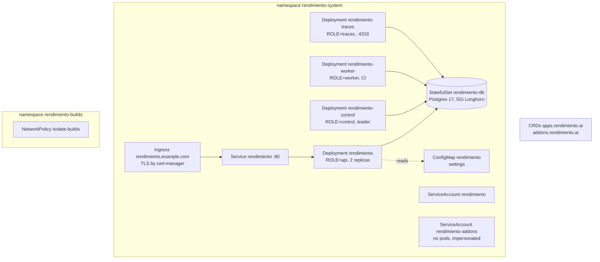
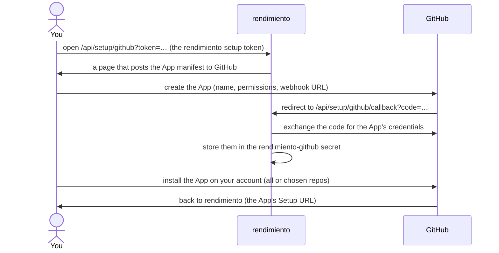

# How the platform is deployed

rendimiento deploys apps, but it does not deploy itself. The platform is installed with plain Kubernetes manifests in [`deploy/`](https://github.com/rendimiento-ai/rendimiento/tree/main/deploy), applied with `kubectl apply -k deploy`. Keeping the platform outside its own control means a broken rendimiento can always be fixed with `kubectl`.

## Your own settings

The manifests in `deploy/` carry **example values** (`example.com`, `registry.example.lan`, `you@example.com`). A real cluster's settings belong in a **private overlay**, a kustomization in a private repository that builds on `deploy/` and replaces what differs:

```yaml
# kustomization.yaml in a private repository, next to a clone of this one
resources:
  - ../../rendimiento.ai/deploy
images:
  - name: registry.example.lan:5000/rendimiento
    newName: registry.home.lan:5000/rendimiento   # your registry
patches:
  - path: configmap.yaml          # the rendimiento ConfigMap with your settings
  - target: { kind: Ingress, name: rendimiento }
    patch: |-
      - { op: replace, path: /spec/rules/0/host, value: rendimiento.your-domain.com }
      - { op: replace, path: /spec/tls/0/hosts/0, value: rendimiento.your-domain.com }
```

Then point the Makefile at it from a `local.mk` (git-ignored) at the repository root:

```makefile
IMAGE := registry.home.lan:5000/rendimiento
DEPLOY_DIR := $(HOME)/private-repo/rendimiento-platform
TEST_EXCLUDE_NODES := my-gpu-node     # nodes remote tests must avoid
ITEST_REGISTRY := registry.home.lan:5000
```

`make deploy` renders `DEPLOY_DIR` (`deploy/` by default) and applies it. Your hostnames, node names and email then never enter the public repository.

## What gets installed



| File | What it contains |
|---|---|
| `kustomization.yaml` | The list below, applied together. |
| `namespace.yaml` | `rendimiento-system` (the platform) and `rendimiento-builds` (CI pods). |
| `crds/rendimiento.ai_apps.yaml`, `crds/rendimiento.ai_addons.yaml` | The two custom resource definitions, **generated** from `api/v1alpha1` by `make generate`. Never edit them by hand. |
| `rbac.yaml` | What the platform may do (see below), the `rendimiento-addons` identity bound to `cluster-admin`, and the build namespace's Role. |
| `postgres.yaml` | The platform database: a one-replica StatefulSet on a 5 Gi Longhorn volume. |
| `rendimiento.yaml` | The settings ConfigMap, the Deployment, its Service and Ingress. |
| `networkpolicy.yaml` | Isolation for CI pods: DNS, BuildKit and the public internet only. |
| `railpack/Dockerfile` | Not applied: the image with the Railpack CLI that build pods use (`make railpack-image`). |

??? example "deploy/rendimiento.yaml (settings, Deployment, Service, Ingress)"
    ```yaml
    --8<-- "deploy/rendimiento.yaml"
    ```

??? example "deploy/rbac.yaml"
    ```yaml
    --8<-- "deploy/rbac.yaml"
    ```

??? example "deploy/networkpolicy.yaml"
    ```yaml
    --8<-- "deploy/networkpolicy.yaml"
    ```

### Permissions, and why they are shaped this way

The platform's own service account (`rendimiento`) can:

- manage the `App` and `Addon` resources;
- manage namespaces, Deployments, Services, Ingresses, CronJobs, PVCs and Secrets **cluster-wide**, because every app gets its own namespace. The controller refuses namespaces and hostnames it does not own ([ownership checks](../architecture/controller.md#ownership-checks));
- read nodes, metrics, ingress classes, storage classes, CRDs, cluster issuers and StatefulSets, for the Environment and Services pages;
- create and delete pods and secrets in `rendimiento-builds` (CI);
- get and update, by name, its own `rendimiento-dns`, `rendimiento-notify`, `rendimiento-ia`, `rendimiento-logs` and `rendimiento-umami` secrets, and in `cert-manager` the one secret the ClusterIssuer reads its Cloudflare token from (`cloudflare-api-token-secret` here; patch the name in your overlay, or set `certManagerSecret.name` with Helm), for [Keys and settings](#keys-and-settings). When these Roles are new or name more secrets (as `rendimiento-logs` and `rendimiento-umami` did), run `make deploy` (or `helm upgrade`) once after updating to apply them;
- **impersonate** the `rendimiento-addons` service account, and nothing more.

`rendimiento-addons` is bound to `cluster-admin`, because installing software like Longhorn means creating CRDs, ClusterRoles and DaemonSets, exactly what ArgoCD needed. No pod runs as it: only the add-on controller acts as it, so the Kubernetes audit log shows every add-on change under that name. See [Security model](../architecture/security.md).

## Secrets you create once

| Secret (namespace `rendimiento-system`) | Keys | Used for |
|---|---|---|
| `rendimiento-db` | `password` | Postgres password (the Deployment builds `DATABASE_URL` from it) |
| `rendimiento-setup` | `token` | One-time token that protects the [setup page](#installing): picking the forja and the first administrator |
| `rendimiento-dns` (optional) | `CLOUDFLARE_API_TOKEN`, `DNS_TARGET` | DNS automation. `DNS_TARGET=auto` follows the home network's public IP. |
| `rendimiento-github` | created by the setup flow | The GitHub App's ID, private key, webhook secret and OAuth client |

```bash
kubectl -n rendimiento-system create secret generic rendimiento-db --from-literal=password="$(openssl rand -hex 24)"
kubectl -n rendimiento-system create secret generic rendimiento-setup --from-literal=token="$(openssl rand -hex 16)"
# a Cloudflare token with Zone:DNS:Edit on your zones, entered without echoing it:
read -rs CF && kubectl -n rendimiento-system create secret generic rendimiento-dns \
  --from-literal=CLOUDFLARE_API_TOKEN="$CF" --from-literal=DNS_TARGET=auto; unset CF
```

## Installing: the setup page {#installing}

A new platform opens on its setup page, in three steps:

1. **The setup token** (the `rendimiento-setup` secret; on a computer, the file the page names). It is the key: without it nobody can pick a forja or become an administrator. A good token opens an *install session* in that browser, for an hour: a cookie signed with the token (the token itself never travels in it).
2. **Where your code lives**: GitHub, GitLab or Bitbucket. Pick one to start; the others connect later on the Environment page.
    - **GitHub**: the App is created with one click, from its manifest ([below](#the-github-app)).
    - **GitLab** (gitlab.com or your own): an OAuth application of your group. The page asks for the address (`https://gitlab.com` by default), the application ID and its secret, and shows the redirect URI to copy into GitLab, `<baseURL>/api/forjas/gitlab/callback`, with the scopes `api` and `read_user` ([Connecting GitLab](../guide/gitlab.md#creating-the-oauth-application)).
    - **Bitbucket** (Bitbucket Cloud): an OAuth consumer of your workspace. The page asks for the workspace, the key and the secret, and shows the callback URL, `<baseURL>/api/forjas/bitbucket/callback` ([Connecting Bitbucket](../guide/bitbucket.md#creating-the-oauth-consumer)).
3. **Who administers**. Whoever authorized the forja in step 2 comes back signed in, as the **first administrator**, even if `ALLOWED_USERS` does not name them: they proved the setup token. With GitHub, they sign in with it once the App is installed. They add the other administrators now (the forja and the username: `ana`, `ana@gitlab.com`, `ana@bitbucket.org`) or later on [Members](../guide/members.md#the-first-administrators), and press **Finish and go in**.

The OAuth answer is bound to the install session: the forja's state comes back to the browser that started, with that browser's session, or nobody becomes an administrator. Once the platform is installed (the setup page finished, or an administrator and a forja exist), every door of the setup page answers *not found*, even with the token. An administrator connects GitHub afterwards from the Environment page, with no token: its card says **Connect GitHub**, as the others do.

## The GitHub App

rendimiento creates its own GitHub App with the **manifest flow**, so nobody fills in GitHub's forms by hand:



The manifest asks for these repository permissions: **Contents** read & write (read code, push onboarding branches), **Pull requests** read & write (open onboarding PRs), **Checks** read & write (report CI status), **Metadata** read, **Issues** read & write and **Commit statuses** read (both for the Renovate add-on). It subscribes to **push** events. Signing in with GitHub uses the same App's OAuth, and only [members](../guide/members.md) get a session (the setup page makes the first administrator; `ALLOWED_USERS` can name more).

!!! tip "Changing the App's permissions later"
    Change them at `https://github.com/settings/apps/<app-name>/permissions`, then **accept** the new permissions on the installation (`https://github.com/settings/installations` → Configure). Until accepted, installations keep the old ones; the Add-ons page warns when Renovate lacks what it needs.

!!! note "Installing on an organization"
    The manifest makes a **private** App, which only its owner's account can install. To install it on an organization (the [Mercado](../guide/mercado.md)'s `PAGES_ORG`), make it public (`https://github.com/settings/apps/<app-name>/advanced` → *Make public*) after setting `GITHUB_ACCOUNTS` to the accounts rendimiento uses: anyone can then install the App, and rendimiento leaves every other installation out of the wizard and ignores its pushes.

## Shipping a new version of rendimiento

```bash
make test-remote     # the full test suite, on a worker node
make image           # build and push registry.example.lan:5000/rendimiento:latest on the BuildKit pool
make deploy          # kubectl apply -k deploy (only needed when deploy/ or the CRDs changed)
kubectl -n rendimiento-system rollout restart deploy   # every service
kubectl -n rendimiento-system rollout status deploy/rendimiento
```

The platform runs as [services from one image](../architecture/overview.md#three-services): `rendimiento` (`ROLE=api`, two replicas behind the Service), `rendimiento-control`, `rendimiento-worker`, `rendimiento-traces` and `rendimiento-agents`. Each pulls `:latest` with `imagePullPolicy: Always` and updates with **no downtime**: a `RollingUpdate` with `maxUnavailable: 0` starts the new pod next to the old one, and the old one keeps working until the new one is ready. For those seconds both versions run:

- **live events** (log lines, step changes, cancels) cross between them through Postgres ([Live updates](../architecture/api-ui.md#live-updates-server-sent-events)), so a run page served by one shows the build the other runs;
- the old control pod hands the **leader lease** to the new one as it stops; only the leader runs the controllers, Renovate, the add-on sync, the uptime prober, release verification and dynamic DNS;
- the new worker waits for the **queue's lock**; a run the old one was building when it stopped goes back to the queue, as on any restart.

Apps keep running either way: they do not depend on the platform being up.

!!! warning "Migrations stay compatible with the previous version"
    The new version applies its migrations while the old one still serves. A migration only adds (tables, nullable columns or columns with a default, indexes); renaming or dropping something the previous version reads waits for a later release, once nothing uses it.

On restart the platform:

1. applies database migrations (`internal/store/migrations`), each once;
2. the worker, once it holds the run queue's lock in Postgres (a second copy waits for it), requeues CI runs a previous process left running (up to two retries) and deletes leftover build pods;
3. the control service, once elected, closes Renovate runs that were interrupted, resumes release verifications, and starts the controllers, the Renovate scheduler, the add-on sync from git, and dynamic DNS.

!!! warning "`:latest` has no history"
    Rolling back a hand-built platform means rebuilding the previous commit (`git checkout <good commit> && make image`). The images rendimiento builds itself are kept by release, so [updating from the Environment page](#updating-from-the-environment-page) has a history to go back to.

### The public image {#the-public-image}

Every change that reaches `main`, and every `v1.2.3` tag, is also published for **arm64 and amd64** at `ghcr.io/rendimiento-ai/rendimiento`, by a GitHub Actions workflow (`.github/workflows/imagen.yml`) that only builds and publishes: the tests ran in rendimiento before the merge. Its tags are `:main` and `:sha-<commit>` for `main`, and `:1.2.3`, `:1.2` and `:latest` for a release. To install on another cluster, point the Deployments' `image:` at one of them instead of building your own. The Dockerfile cross-compiles, so the image for the other architecture needs no emulation.

### Installing with Helm {#installing-with-helm}

`chart/rendimiento` installs the platform on another cluster from the public image, without an overlay of your own. Each release from `v0.1.3` on publishes it with its version, and it installs that release's image; without `--version`, Helm takes the latest (add `--version 1.2.3` to pin one):

```bash
helm install rendimiento oci://ghcr.io/rendimiento-ai/charts/rendimiento \
  -n rendimiento-system --create-namespace \
  --set baseURL=https://rendimiento.example.com \
  --set registry.host=registry.example.com
```

From a clone of this repository, `./chart/rendimiento` installs the image of `main` (`appVersion: main`):

```bash
helm install rendimiento ./chart/rendimiento -n rendimiento-system --create-namespace \
  --set baseURL=https://rendimiento.example.com \
  --set registry.host=registry.example.com
```

`--set firstAdmins=ana,luis@gitlab.com` names more administrators from the start (the names of [Members](../guide/members.md#adding-someone)); it is optional, since whoever installs from the setup page becomes one.

It brings the five services, Postgres, a rootless BuildKit daemon, the build namespace with its NetworkPolicy, the RBAC and the CRDs, and it makes the database password and the setup token (kept across upgrades). Then open `baseURL` and follow the [setup page](#installing) (GitHub, GitLab or Bitbucket); `helm` prints how to read the setup token.

What the cluster still needs:

- **An image registry your nodes trust.** Builds push app images to `registry.host`, and the nodes pull them from the same name without credentials (a public registry, or one the nodes are configured for, as in k3s's `registries.yaml`).
- **An ingress controller** (`ingress.className`, `nginx` by default), and cert-manager with a ClusterIssuer if you want certificates (`ingress.clusterIssuer`).
- **A default StorageClass**, or `storageClass`.

**Without a domain, on your own computer.** When `baseURL` is a `.localhost` address (`http://rendimiento.localhost:8080`, as with k3d or kind and a port of the computer forwarded to the ingress), rendimiento behaves as it does [installed on one computer](#on-one-computer): each app's first service answers at `http://<app>.localhost` on the same port, over plain HTTP, with no certificate, DNS record or check from outside; and since GitHub cannot reach it with a webhook, it asks GitHub for new commits every `POLL_INTERVAL` (1 minute). A service with a `domain` of its own is published as anywhere else. The [quickstart](../start/quickstart.md#on-a-cluster) has the commands for k3d. With `ingress.clusterIssuer` empty, every app is published over plain HTTP, whatever its domain.

`postgres.bundled=false` with `postgres.existingSecret` (a key `url`) uses your own database, and `buildkit.bundled=false` with `buildkit.address` your own BuildKit. `addons.enabled=false` leaves out the cluster-admin identity add-ons need. Every other setting goes in `config` (see [Configuration](../reference/config.md)), and the optional secrets (DNS, email, AI, log archive) are read by name as in `deploy/`. The chart installs one platform per cluster: its cluster-wide objects keep fixed names.

## On one computer, without Kubernetes (preview) {#on-one-computer}

`MODE=local` runs rendimiento on a computer with containerd (nerdctl, recommended) or Docker, in one process: the UI and the API on `127.0.0.1:8080`, CI, and the agents. On Linux, the installer sets it all up:

```bash
curl -fsSL https://rendimiento.ai/instalar | sh
```

It uses the engine the computer has (containerd, or Docker when your user can use it), or installs containerd for your user, without root (it asks before, and uses `sudo` once: `/usr/local`, `uidmap`, and an AppArmor profile for `rootlesskit` on recent Ubuntu). With either engine it turns on lingering for your user, so rendimiento keeps running while you are signed out (a server reached over SSH) and starts with the computer; when it cannot, it says so and how to do it later. It downloads the program of the latest release (published for amd64 and arm64 with its `SHA256SUMS`, which it checks) to `~/.local/bin`, and leaves it as a service of your user (`systemctl --user status rendimiento`) that starts with the computer. It does not ask who administers: it ends by opening the [setup page](#installing) with the setup token in its address (printed too when the terminal is yours), where you pick where your code lives and, by authorizing it, come back as the first administrator. With a terminal it asks first where your code lives, only to open the page on it: GitHub, GitLab (its address, `https://gitlab.com` by default), Bitbucket, or "I will choose on the setup page". `--forja github|gitlab|bitbucket` and `--gitlab <address>` (or `RENDIMIENTO_FORJA` and `RENDIMIENTO_GITLAB`) answer it ahead:

```bash
curl -fsSL https://rendimiento.ai/instalar | sh -s -- --forja gitlab --gitlab https://git.example.com
```

Scripts can still name the first administrators ahead with `RENDIMIENTO_ADMINS` (or by its old name, `RENDIMIENTO_GITHUB`), in the names of [Members](../guide/members.md#adding-someone): `ana` on GitHub, `ana@gitlab.com` or `ana@git.example.com`, `ana@bitbucket.org`, comma-separated. They go in the service's `ALLOWED_USERS`, which only counts while there are no members. `RENDIMIENTO_VERSION` and `RENDIMIENTO_SI=1` (yes to every question, and no question about the forja) complete the list. By hand, it is:

```bash
MODE=local ./rendimiento
```

and then `http://localhost:8080`, with the setup token from `~/.config/rendimiento/ficha-configuracion`.

To take it off the computer again:

```bash
curl -fsSL https://rendimiento.ai/instalar | sh -s -- --desinstalar
```

It stops and removes the service, its own containers (`rendimiento-postgres`, `rendimiento-registro`, `rendimiento-buildkit`), your apps' containers and networks, and the program. Then it lists what is left of your data (its volumes, your apps' Postgres and Redis, the caches, and `DATA_DIR` with the secrets' key) and deletes it only if you answer yes; `RENDIMIENTO_SI=1` never answers that one, `RENDIMIENTO_BORRAR_DATOS=1` does. Kept data is picked up again by the next install, and remembered in `DATA_DIR/volumenes` for a later uninstall. It only touches what carries rendimiento's names or labels, and the container engine stays.

On its first start it makes, in `DATA_DIR` (by default `~/.config/rendimiento`, readable only by you), the key that seals its secrets in Postgres, the database's password and the setup token. It starts and keeps two containers of its own: `rendimiento-postgres` (on `127.0.0.1:55433`) and `rendimiento-registro` (an image registry on `localhost:5000`, or the one already answering there). Builds use BuildKit: the one containerd's tools set up (`containerd-rootless-setuptool.sh install-buildkit`), or, under Docker, a container of its own.

When you do not need it, rendimiento can [sleep](../guide/dormir.md): the apps and the CI stop, and it wakes as it was; **Shut down completely** also stops it until the computer starts.

Its settings are environment variables, and the service reads yours from `DATA_DIR/env` (`~/.config/rendimiento/env`), one `NAME=value` per line: the installer makes that file the first time and never writes it again, while it writes the service's unit anew on every run. After a change, `systemctl --user restart rendimiento`. The **Environment** page (for the platform's administrators) shows the file and that command; [Settings](../reference/config.md#on-one-computer) lists every variable.

No forja can send webhooks to `localhost`, so the GitHub App made by the setup page has none, and a GitLab or Bitbucket app gets none either (gitlab.com refuses to add one): every `POLL_INTERVAL` (1 minute) rendimiento asks each app's forja for its branches and runs a branch whose head moved, as a push would.

GitLab and Bitbucket work on one computer as they do on a cluster: the setup page shows the redirect URI to copy into the OAuth application (`http://localhost:8080/api/forjas/gitlab/callback`, or `/api/forjas/bitbucket/callback` for the workspace's OAuth consumer), and a plain `http://localhost` address is accepted there, because it is your browser that follows it: nothing on the internet has to reach the computer. The installer prints the one for the forja chosen.

Releases run on the computer, through the **local destination**: each service of a release is a container on the app's own network, published on `127.0.0.1` and reached through rendimiento's proxy at **`http://<app>.localhost:8000`** (the app's first service) or `http://<service>.<app>.localhost:8000` (`PROXY_LISTEN` moves it). A new release starts beside the running one; once it answers (its `health` path, or its port), the proxy goes to it and the old containers are removed, and one that never answers is removed and leaves the running one in place, as release verification then reports. Its port must really answer: a connection that the published port accepts and closes at once (nothing listening behind it) does not count. The failure says why: where the service listens inside its container when that is not its `port` (or only on `127.0.0.1`), when it looks for Redis or Postgres on `localhost` (inside a container that is the container itself: use `REDIS_URL` or `DATABASE_URL`), and its last lines. An app that needs Postgres or Redis gets a container of each, with a password made once and sealed; its secrets (Settings → Secrets) are sealed too. The containers restart with the computer. A service reaches another service of its app **by its name**, as in the cluster: each container answers on the app's network to its service's name (its hostname under containerd, a network alias under Docker), so `http://api:8000` or an nginx `proxy_pass http://wellness-api` work unchanged, and a need injects that address (`API_URL`). Postgres and Redis answer to `postgres` and `redis`. After a rollout with more than one service, the new containers start again once, so none keeps an address of the old release. Another app's services are not reachable there. Not there yet: certificates for an app's own domain, and the tunnel that puts it on the internet; then a native app for each system (the one for Windows is [a preview](#on-windows)).

### On Windows (preview) {#on-windows}

**rendimiento for Windows** is an app that sets up and keeps everything above on Windows 10 (version 2004 or newer) or Windows 11, on a computer with a 64-bit Intel or AMD processor, without Docker Desktop: rendimiento runs in a small WSL2 distribution of its own, and the app is its window. Download `rendimiento-windows-amd64.exe` from the [latest release](https://github.com/rendimiento-ai/rendimiento/releases/latest) and open it. It is one program, with no installer yet: keep it where you like, and open it again to come back.

!!! note "It is not signed yet"
    The first time, Windows SmartScreen stops it with "Windows protected your PC": choose **More info**, then **Run anyway**. To check the download before that, compare `Get-FileHash rendimiento-windows-amd64.exe` with its line in the release's `SHA256SUMS`. A signature and an installer come next.

The first time, an assistant does what is missing, one step at a time:

1. **WSL2.** If Windows does not have it on, the assistant turns it on: Windows asks for an administrator's permission, and then to restart. Open the app again after that.
2. **The distribution.** It downloads the latest release's `rendimiento-wsl-amd64.tar.gz` (about 174 MB), checks it against that release's `SHA256SUMS`, and imports it as the WSL distribution `rendimiento`. It does not touch other distributions you have.
3. **Start.** Right after the import it starts rendimiento and keeps the distribution awake (WSL stops one that nothing is attached to). Nobody is named before: there is no login to type.
4. **Setup.** **Open the setup page** takes the window to rendimiento's [setup page](#installing) with the setup token already in hand, where you pick where your code lives (GitHub, GitLab or Bitbucket) and, by authorizing it, come back as the first administrator. GitHub makes rendimiento's app with one click. For GitLab or Bitbucket, create the OAuth application in your browser (the window has no address bar; the setup page shows the redirect URI, a plain `http://localhost:8080` one, which both accept) and paste its ID and secret in the window.

When a step cannot go on, the assistant says why and what to do: virtualization that is off in the computer's BIOS/UEFI (`HCS_E_HYPERV_NOT_INSTALLED`, `ERROR_NOT_SUPPORTED`), a download that does not match its checksum, or a clock that is off, which makes GitHub refuse rendimiento's signature. The first and the last are explained [below](#on-windows-by-hand).

From then on the app is a window of its own showing rendimiento (`http://localhost:8080`), and an icon next to the clock. Your apps answer on `http://<app>.localhost:8000`, as on Linux. Closing the window leaves the icon there, with this menu:

- **Open**: the window again.
- **Back to the start**: takes the window off whatever site it was left on (a forja's sign-in, say) and back to the assistant, or to rendimiento when everything is ready.
- **Open in the browser**: rendimiento in your browser.
- **Sleep**: stops the distribution, and with it your apps, the builds and the memory it held. The data stays. **Wake up** starts it again.
- **Quit**: closes the app; with nothing keeping it awake, WSL stops the distribution soon after.

The window has a menu of its own, **Navigate**, for the pages that are not rendimiento's (the forja's, and those it sends you to for signing in): **Back** goes to the page before, as in a browser, and **Back to the start** does the same as in the icon's menu.

Where things live:

- the program, wherever you saved it;
- `%LOCALAPPDATA%\rendimiento`: the distribution's disk (rendimiento, your apps and their data) and what the app downloaded;
- inside the distribution (`wsl -d rendimiento`): its settings in `/etc/rendimiento/env` (one `NAME=value` per line; after a change, `wsl -d rendimiento -- systemctl restart rendimiento`; see [Settings](../reference/config.md#on-one-computer)), and the secrets' key and the setup token in `/root/.config/rendimiento`.

Not there yet: an installer, a signature, updating itself, uninstalling, starting with Windows, and computers with an ARM processor. To remove it today, choose **Quit**, delete the program, and in PowerShell:

```powershell
wsl --unregister rendimiento                          # the distribution, with all its data
Remove-Item -Recurse $env:LOCALAPPDATA\rendimiento    # what the app downloaded
```

### On Windows, by hand {#on-windows-by-hand}

The same steps, for those who prefer to run them. The distribution is the `rendimiento-wsl-amd64.tar.gz` of each release: Debian with systemd, containerd, BuildKit and rendimiento in `MODE=local`, built from `instalar/wsl`. In PowerShell:

```powershell
wsl --install --no-distribution   # only if WSL is not on yet; it may ask to restart
curl.exe -LO https://github.com/rendimiento-ai/rendimiento/releases/latest/download/rendimiento-wsl-amd64.tar.gz
wsl --import rendimiento $env:LOCALAPPDATA\rendimiento rendimiento-wsl-amd64.tar.gz
```

Nothing has to be named first. Start it (`wsl -d rendimiento`, and keep that window open) and, once `http://localhost:8080` answers, read the setup token with `wsl -d rendimiento -- cat /root/.config/rendimiento/ficha-configuracion`. Open `http://localhost:8080`, paste it, and pick where your code lives: whoever authorizes it there becomes the first administrator. To name administrators ahead instead (`ana`, `ana@gitlab.com`, `ana@bitbucket.org`), write `ALLOWED_USERS=...` in `/etc/rendimiento/env` and `wsl -d rendimiento -- systemctl restart rendimiento`. Your apps answer on `http://<app>.localhost:8000`, as on Linux. It does not touch other distributions you have. WSL stops a distribution when no `wsl.exe` is attached to it, so keep a `wsl -d rendimiento` window open while you use it (the app does that for you). `wsl --unregister rendimiento` removes it with all its data.

If `wsl --import` fails with `HCS_E_HYPERV_NOT_INSTALLED` or `ERROR_NOT_SUPPORTED`, WSL2 cannot start its virtual machine yet: restart Windows after `wsl --install --no-distribution` (its components only work after a restart), and check that virtualization is on (Task Manager → Performance → CPU says "Virtualization: Enabled"; if not, turn on SVM Mode on AMD or Intel Virtualization Technology on Intel in the computer's BIOS/UEFI).

If GitHub answers "Bad credentials" while setting up or adding an app, look at the clock: GitHub refuses the app's signature when the computer's clock is off by more than a minute, and rendimiento says by how much. Turn on "Set the time automatically" with your time zone in Windows (Settings → Time & language), press "Sync now", then `wsl --shutdown`. On a computer that also starts Linux, the two may keep the hardware clock differently (Linux in UTC, Windows in local time); `timedatectl set-local-rtc 1` in Linux makes them agree.

## rendimiento builds itself {#rendimiento-builds-itself}

rendimiento's repository is onboarded like any app. Its `rendimiento.yaml` has the book (`docs`, a service) and the platform's own image (`builds: platform`), so every push runs:

- `platform:test`: `hack/ci-test.sh` with `CI_PARTE=resto` (generate, vet and the Go tests but the API's and the platform's, with a throwaway Postgres; then `internal/controller`'s envtest, alone, and the Windows app's module, `escritorio/`) in `golang`, with a kept cache;
- `pruebas-api:task` and `pruebas-plataforma:task`: the same script with `CI_PARTE=api` and `CI_PARTE=plataforma`, the two longest packages, each with its own Postgres, at the same time on other nodes;
- `interfaz-en:task` and `interfaz-es:task`: the browser tests in English and in Spanish, at the same time, each with its own test server and database;
- `platform:build`: the Dockerfile, which also checks the UI's types and translations, pushed as `<registry>/rendimiento-ai-platform:<commit>`.

Pull requests get the same check without a release. On the default branch the image's digest is kept with the release, next to the book's.

### Knowing a new version is published {#knowing-a-new-version-is-published}

Once a day rendimiento asks GitHub which version is published. The platform's administrators (and nobody else) see it on a **Version** card: on the Environment page, and on the home page whenever a newer one is out. The card says the version running, the newest with the first lines of its notes, whether it only brings **fixes** (0.2.0 → 0.2.1) or **new features** (0.3.0), and whether it is **signed**. On a **computer** (Linux, and the WSL distribution under Windows) **Update** installs it: rendimiento downloads the release, checks that its `SHA256SUMS` is signed with rendimiento's key and that the program's sum is the one listed (an unsigned release is never installed), keeps the program that runs as the previous one, puts the new one in its place and restarts through its service; your apps keep running meanwhile. If the new version fails to start three times before staying up two minutes, rendimiento goes back to the previous one by itself and the card says so. **Go back** puts the previous version back, only ever a lower one. On Windows, the window follows the rendimiento inside it: every 10 minutes it asks the inside's version (rendimiento tells it only to this computer), and when the inside is newer it downloads its own program of that version, checks its signature and sum the same way, and puts it in its place; the new window opens next time. With **Install fix releases by myself** on (off at first), a computer checks every hour and installs a release with the same major and minor version (0.2.0 → 0.2.1) when it is signed; one with new features (0.3.0) waits for a click, and one that already failed to stay up here is never installed by itself again. In a cluster installed with the chart, the card shows the `helm upgrade` command instead. A cluster that builds rendimiento itself has its version once, in the Environment page's header and its Platform figure (below).

### Updating from the Environment page {#updating-from-the-environment-page}

With `SELF_APP` set to the app rendimiento's repository is onboarded as, the platform knows which of those releases it runs (by the digest of its pod's image). When the newest release holds another image, the **Environment** link shows *new* and the Environment page has an **Update to release #n** button in its header, the only one; its **Platform** figure says the release that runs, whether a newer one is ready, and links to the releases. When the platform's manifests changed, a notice under the figures says `make deploy` is needed and which files changed. It replaces the steps above for a version that passed its checks:

1. the button points the platform's Deployments (`SERVICES`) at the release's image, pinned by digest (`<registry>/rendimiento-ai-platform@sha256:…`), and notes the release and who pressed it on the pod template;
2. each Deployment rolls over as above (the old version works until the new one is ready), and the new processes apply their migrations;
3. the page waits until the new version answers, then reloads.

`make deploy` keeps that image (`hack/keep-image.sh` puts the running digest in place of the overlay's), so changing the configuration does not take the platform back to `:latest`. It is still how `deploy/` and the overlay's changes reach the cluster; the button only changes the image. To tell when that is needed, `make deploy` records the commit it applied (the `rendimiento.ai/manifests` annotation on the Deployment), and the Environment page compares it with the newest release: when a YAML file under `deploy/` changed in between, such as a CRD or the permissions, it says **make deploy is needed** and lists the files, before you update and until you run it. Changes to your private overlay are yours to apply; the page does not see them.

!!! warning "If the new version does not start"
    The old version keeps serving: a release that never becomes ready leaves the rollout stuck, not the platform down. Go back with `kubectl -n rendimiento-system rollout undo deploy/<name>` for each service that is stuck.

To go back to an image built by hand, `kubectl -n rendimiento-system set image deploy --all rendimiento=registry.example.lan:5000/rendimiento:latest`.

!!! note "From one Deployment to three"
    A platform that ran as one Deployment moves to three in two steps, in this order: **Update** to a release that knows `ROLE` (it still runs everything in one process), then `make deploy`, which adds `rendimiento-control` and `rendimiento-worker` with the running image and turns `rendimiento` into the API. The other way round, the new Deployments would start an image that does not know its role.

!!! note "A field the running platform doesn't know"
    The platform reads `rendimiento.yaml` strictly. A change that adds a field to it (as `builds:` did) must be shipped **before** the commit that uses the field is pushed, or that push's run fails to read its own spec.

### Capacity {#capacity}

The Environment page's **Capacity** section shows every node's processor and memory twice: **in use** (from the metrics server) and **reserved**, what its pods ask for. The scheduler places a new pod only where its request fits in what is not reserved, however little the node really uses, so a test that asks for two cores waits on a node that is 15% busy but 94% reserved.

Administrators of the platform change, without a redeploy (every process follows within 15 seconds):

- **takes runs**, per node: runs' steps go only to the nodes that take them, and so do images: a BuildKit daemon on a node that is off builds nothing while another is there (the image builds on another daemon, with the cache it keeps in the registry). Nodes in `BUILD_EXCLUDE_NODES` are always off.
- **Runs at once** and **Runs of one app at once**: override `PARALLEL_RUNS` and `RUNS_PER_APP` (empty keeps them), up to 8. An app's deploys still go one at a time.
- **Caches of each test**: how many volumes a test with `cache: true` keeps (2 when empty, up to 6). A run's test takes the first that no other run is using, so that many runs test at once without waiting for a cache. Each is a volume of `TEST_CACHE_SIZE`, made the first time it is needed; lowering the number leaves the extra ones unused until their app is deleted.
- **A node is busy from (%)**: every 15 seconds the platform measures each node's CPU and memory, reserved and in use; one at this percent or more (85 by default) shows *busy*, and new steps go to the other nodes when one has room for them. It is a preference, not a rule: a step made while most nodes are busy still goes to a busy one once it fits there, instead of waiting for the only node left, which may never have room. BuildKit daemons on busy nodes are left out while another is ready. 100 turns it off.
- **Most CPU a step reserves**: lowers what any step's pod asks for, so steps fit on busy nodes; with no CPU limit they still use the free cores they find. Empty: what each app's `resources` asks.

A node kept for other work, such as one that serves a language model and needs its memory, can stay out of CI for good, by a label rather than by its name, so the rule follows the machine: `kubectl label node <node> rendimiento.ai/construye=no` (or the `node-label` of its k3s agent). No step of any run goes there, its BuildKit daemon builds nothing, and it is left out of the busy count. Your apps still run there as before. `rendimiento.ai/construye=si` is the other way: a node that prefers CI, like a node «a ratos».

### The Environment page {#the-environment-page}

On a cluster, the Environment page says first how things go, then what needs you:

- **How it goes**: a sun that turns slowly, with *Everything running*, *Running, with notices* or *Something is down*, and how many things are down (a required check that fails, a node not ready) and how many notices there are (an optional check, an unhealthy workload or certificate). Beside it, the nodes ready, the apps online with their valid certificates, and the platform's release.
- **What needs you**: a card for each check that is not well and each failing pod or certificate, with its action: **Change it** for the Cloudflare token, **See** to open its service below or to show how to fix it.
- **The nodes**: each node is a small house. Its lit windows are the processor, the pink skirting rises with its memory, a note floats over it when it is not ready, under pressure, cordoned or nearly full, and the node in charge has a clock tower. Pressing one shows its details.
- **What it connects to**: where the code lives, DNS, certificates, email, the builder, the image registry, backups and AI, each with a dot that breathes green, amber or red. Pressing one opens its window: the dynamic DNS, the test email, the forjas, its checks, and **Change its key**.

Folded below: [Capacity](#capacity), every check by category, and, for administrators, the live settings. Animations stop when the device asks for reduced motion.

### Keys and settings {#keys-and-settings}

**Keys and settings** (`/environment/llaves`, administrators only) lists every key rendimiento talks to other services with: its purpose, when it expires (*Expires in 21 days*, or *Does not expire*) and when it was changed here. Never its value.

Five keys change here, each **tested before it is saved**:

| Key | The test | Where it is saved |
|---|---|---|
| Cloudflare token | Cloudflare accepts it and says until when (`/user/tokens/verify`); it sees every zone the apps and `DNS_ZONE` are in; it creates and deletes a TXT record `_rendimiento-prueba` in `DNS_ZONE` | `rendimiento-dns` (`CLOUDFLARE_API_TOKEN`), and the secret of the `CLUSTER_ISSUER`'s DNS-01 solver (its `apiTokenSecretRef`, in `CERT_MANAGER_NAMESPACE`) |
| Email (Resend) | Resend accepts it (asking for its domains, which sends nothing), and its account has the domain of `NOTIFY_EMAIL_FROM`; a test email only when asked | `rendimiento-notify` (`RESEND_API_KEY`) |
| Platform AI | Anthropic answers with it for `AI_PLATFORM_MODEL` | `rendimiento-ia` (`AI_PLATFORM_KEY`) |
| Log archive (S3): an access key's id and secret | the archive at `LOG_ARCHIVE_ENDPOINT` accepts it; the bucket `LOG_ARCHIVE_BUCKET` is there; it writes a small object under `_rendimiento-prueba/`, reads it back and deletes it (the archive deletes old logs with the same key) | `rendimiento-logs` (`LOG_ARCHIVE_ACCESS_KEY` and `LOG_ARCHIVE_SECRET_KEY`, together) |
| Visits (Umami): a user name and password | Umami at `UMAMI_URL` lets the user in; it sees at least one website (a view-only user is enough) | `rendimiento-umami` (`UMAMI_USERNAME` and `UMAMI_PASSWORD`, together) |

If any step fails, **nothing is saved** and the page says which step and why (*It does not see example.org: add it under «Zone Resources»*); the key before keeps working. When every step passes, the key is written to both secrets or to neither, and the platform uses it **with no restart**: the process that saved it at once, every other within 15 seconds (it sees the key's new version in the database and reads its secret again). cert-manager reads its secret each time, so certificates follow too. The database and the bitácora keep which key, who changed it, when, and when it expires; the value is only in its secrets. A Cloudflare token that expires is warned about 30 days before, in *What needs you*.

A key changes here only where the platform already uses its service: Cloudflare, email, the log archive (`LOG_ARCHIVE_ENDPOINT`) and Umami (`UMAMI_URL`) are set up at install (Helm, or the secrets above); the AI key can start here. Its secret must exist already: the platform may update its own secrets, not create them.

The **off-site backups (R2)** are listed, marked *Outside rendimiento*, and do not change here: a job outside the platform (an rclone CronJob in its own namespace, with its own secret) copies the backup bucket to R2, and rendimiento does not write secrets it does not own. Change that key where the job is set up.

#### Settings tested before they change {#settings-tested-first}

Six settings the platform reads when it starts change here too, each after its **connection test**. Pick one, write the new value beside the one of now, and press **Test the connection**: nothing changes yet. Only when every step passes is **Change** enabled, for those very values, within 15 minutes; the page says first what happens to what already exists.

| Setting | The test | What happens to what exists |
|---|---|---|
| Image registry (`REGISTRY`) | it answers the registry API (`/v2/`); BuildKit pushes a tiny test image to it (`rendimiento-prueba`, `FROM scratch`); a pod on every ready, uncordoned node pulls it; the test image is deleted (a registry that does not allow deletes keeps it, a few bytes) | apps keep their images; new builds go to the new registry, with no cache at first |
| DNS zone and target (`DNS_ZONE`, `DNS_TARGET`) | the Cloudflare token in use sees the zone and creates and deletes a test record in it; the target is an IP, resolves, or is `auto` | records point to the new target at their next check |
| Certificate issuer (`CLUSTER_ISSUER`) | the ClusterIssuer exists and cert-manager says it is ready | certificates are renewed by the new issuer |
| Storage (`STORAGE_CLASS`) | the StorageClass exists; a 64 MiB test volume binds (with a pod that uses it when the class waits for one), then both are deleted | volumes that exist keep their class (it cannot change); new ones use the new class |
| Entrance (`INGRESS_CLASS`) | the IngressClass exists, and a ready pod of its controller runs | every app's ingress moves to the new controller |
| Public address (`BASE_URL`) | it resolves, and answers over HTTPS, with a valid certificate, as **this** platform (it signs a nonce with a key only its processes have, at `/api/identidad`), so a typo cannot lock anyone out | change it in the forjas' apps too (sign-in and webhooks) |

The test's pods and volume run in the builds' namespace, and go when it ends. If a step fails, nothing is saved and the page says which step and why (*1 of 2 nodes pulled it; not node-b (http: server gave HTTP response to HTTPS client)*).

A change is saved as a platform setting that **wins over the ConfigMap's value**, and the platform's Deployments (`SERVICES`) restart at once to read it, the one answering last: a minute or two, and a run that is going may have to run again. The page shows who changed it and when, and **Back to the ConfigMap's value** forgets it (another restart). If the page cannot be reached, start the platform with `TESTED_SETTINGS=ignore` in its ConfigMap: it then uses the ConfigMap's values alone.

The database, the secrets key, the mode and the role change only with Helm: without them the platform does not start.

## The build side

| What | Where it comes from |
|---|---|
| BuildKit daemons | the `buildkit` add-on (`p0dxD/gitops/buildkit/`): a StatefulSet with one daemon per worker node, and one on a [node «a ratos»](#nodes-a-ratos) |
| Railpack CLI image | `make railpack-image` from `deploy/railpack/Dockerfile`, checksum-pinned |
| Railpack frontend | pulled by BuildKit from `ghcr.io/railwayapp/railpack-frontend` at the pinned version |
| Clone and build client images | `alpine/git`, `moby/buildkit` (the client must match the daemon's version) |

### Nodes «a ratos» {#nodes-a-ratos}

A node «a ratos» is a computer that joins the cluster only sometimes: a desktop that helps CI while it is on. It may be of another architecture than the rest (an amd64 desktop beside arm64 boards). It carries the taint and label `rendimiento.ai/a-ratos=true` and the label `rendimiento.ai/construye=si`, so nothing lands on it but what tolerates the taint: never your apps, the database or the platform.

While it is on:

- **Images get both halves.** The `buildkit` add-on keeps one daemon on it (`buildkitd-a-ratos`, cache in a folder of its own disk). A build makes its usual half on a daemon of the cluster's architecture and, at the same time, the other half there; the platform then writes one OCI index at the image's tag, so the image runs on any node. The build's log says so: `building the amd64 half on …` and `one image for arm64 and amd64`.
- **Tests may run there, and prefer it,** when every image the test runs has that architecture (an image of the platform's registry is asked; a public one is taken to have it) and the test keeps no cache volume.
- **If it is turned off mid-step,** the kubelet ends the step within its grace period (90 seconds) and the platform runs it again once on another node, with a note: `moved: … shut down`.

While it is off, nothing waits for it: images are built for one architecture (the other half's failure is only a note), the Environment page draws its house asleep under a moon, and neither the nodes check nor Problems counts it, or its pods, as down.

Joining one: an Ansible playbook in your private overlay installs the k3s agent with the taint, the labels, the registry's address and a graceful shutdown (a `kubelet.conf.d` drop-in with `shutdownGracePeriod`). The platform reads `REGISTRY` to ask the registry which architectures an image has.
