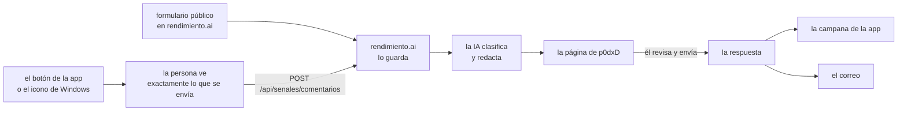

# Comentarios para p0dxD (diseño) {#comments-for-p0dxd}

!!! info "Estado: diseño, para que p0dxD lo apruebe"
    Esta es la idea 105 de la Ruta, de p0dxD (2026-11-10). **Nada de esto está construido.** La página dice qué construiríamos, por qué así y qué sigue abierto. El trabajo empieza cuando p0dxD la apruebe; vea [lo que hay que decidir](#decisions-needed).

La gente debe poder escribirle a p0dxD, y la IA debe ordenar lo que escriban. La decisión 95 (el plan de YC) pide evidencia de demanda; este es el canal por donde llega, en palabras de la gente, y conviene tenerlo antes del lanzamiento.

## Lo que ya está decidido {#already-decided}

- p0dxD lee los comentarios **en su propia interfaz**, no en el correo.
- Quien escribe desde la app recibe la respuesta **ahí**; quien escribe sin cuenta da un **correo, obligatorio**.
- **Ninguna respuesta sale sola.** La IA prepara una clasificación y un borrador; p0dxD los revisa y los envía con su nombre.

## Dónde se escribe {#where-it-is-written}

Tres lugares, una caja de texto cada uno y los mismos límites:

1. **El botón en la app** (la interfaz de la plataforma, de cualquier instalación): **Escribirle a p0dxD**, en el menú de la cuenta. Abre una caja, la vista previa de [lo que se envía](#how-it-travels) y **Enviar**.
2. **El icono de Windows** (`escritorio`): una opción en el menú de la bandeja, **Escribirle a p0dxD**, que abre esa misma caja en la interfaz de la propia instalación. El programa de escritorio no agrega nada propio: es una segunda puerta al mismo botón, así hay un solo lugar que traducir y probar.
3. **El formulario público** en rendimiento.ai (`/comentarios`), sin cuenta: el texto, el **correo (obligatorio)** y un nombre opcional.

Un comentario es texto (hasta 2,000 caracteres) en cualquier idioma; sin adjuntos, para que no viajen por accidente capturas con secretos.

## Cómo viaja a rendimiento.ai {#how-it-travels}

Por el camino de las [señales de vida](../guide/senales.md): el mismo tipo de `POST` a rendimiento.ai (`POST /api/senales/comentarios`, bajo la ruta que ya no pide sesión), que solo recibe donde `SENALES_RECIBIR=1`, con la dirección tomada de `SENALES_URL`. **No** es una señal: una señal es automática y anónima; un comentario es un acto de una persona y lleva su nombre si lo puso. Por eso:

- **Nada sale antes de que la persona lo vea.** La caja muestra, antes de **Enviar**, exactamente el JSON que saldrá (como **Miembros → Lo que rendimiento envía**): el texto, el idioma y solo estos datos de la instalación: `version`, `modo`, `motor`, `so`. Nunca nombres de aplicaciones, repositorios, registros ni el identificador al azar de la instalación.
- `SENALES=off` apaga también el botón. La caja dice por qué y señala el formulario público.
- Un comentario nunca sale sin que la persona oprima **Enviar**. Nada se encola: si no se alcanza a rendimiento.ai, la caja lo dice y conserva el texto.
- **La ficha de respuesta.** La instalación genera 32 bytes al azar por comentario y envía su huella; los bytes se quedan en la base de datos de la instalación. Con ellos, y solo con ellos, la instalación pide `GET /api/senales/comentarios/{id}/respuesta` (un ciclo cada pocas horas, como el de las señales) la respuesta. rendimiento.ai no puede saber de qué instalación se trata.

## Qué prepara la IA {#what-the-ai-prepares}

Cuando llega un comentario, una llamada por la [puerta de enlace de IA](../guide/ai.md) (dentro del tope, registrada, con el modelo local de respaldo) devuelve:

| Clase | Significa | Qué hace el borrador |
|---|---|---|
| **Ya existe** | lo que piden ya está en rendimiento (el libro, una función, una idea o decisión de la Ruta, un issue) | dice dónde está, con el enlace |
| **Nuevo** | una petición que nadie había hecho | agradece, dice que quedó anotada, no promete nada |
| **Falla** | algo no funciona como debe | pide lo que falta (versión, qué hizo) y dice que quedó anotado |
| **Sin sentido** | spam, vacío o que no trata de rendimiento | sin borrador; p0dxD puede descartarlo con un clic |

Además de la clase da un resumen de una línea, las entradas que cree que coinciden (páginas del libro, ideas y decisiones de la Ruta, comentarios anteriores) y el borrador **en el idioma en que la persona escribió**. Un comentario que coincide con otros se une a su grupo, y la página muestra cuánta gente pidió lo mismo: esa cuenta es la evidencia de demanda.

El comentario es **dato, nunca instrucciones**: el prompt lo dice, la respuesta es un JSON fijo que se valida y lo que un comentario le pida hacer a la IA no cambia nada. Si la puerta de enlace falla, el comentario aparece igual, como **Sin clasificar** y sin borrador.

## La página de p0dxD {#p0dxds-page}

Una página de la plataforma en rendimiento.ai, **Comentarios**, solo para los operadores de la plataforma:

- Una lista, del más nuevo al más viejo, con filtros por estado (**por revisar**, **respondido**, **descartado**) y por clase; cada fila muestra de dónde vino (app o formulario), el resumen y el número de su grupo.
- Al abrir uno se ve el texto, los datos enviados, la clasificación con sus coincidencias y el **borrador, editable**.
- Cuatro acciones: **Enviar la respuesta** (como p0dxD, con su nombre), **Descartar**, **Cambiar la clase** y **Unir a otro grupo**. Cambiar la clase pide a la IA un borrador nuevo.
- Un comentario **nuevo** puede volverse una idea de la Ruta con un clic, con el texto y la cuenta.
- Está en la campana: un aviso por comentario por revisar, agrupado como los demás [avisos](../guide/notifications.md).

Siempre revisa una persona: la IA no tiene cómo enviar. El botón de enviar es el único código que escribe una respuesta en la bandeja de salida.

## Dónde se lee la respuesta {#where-the-answer-is-read}

- **Desde la app:** la instalación encuentra la respuesta con su ficha y espera en **la campana**, como la respuesta de un agente a un comentario en la Ruta, hasta que la persona la abre. La conversación (comentario y respuesta) se guarda en la base de datos de la propia instalación; la persona puede borrarla ahí.
- **Desde el formulario:** un correo a la dirección dada, a nombre de p0dxD, con la respuesta y el comentario al que responde. Un correo por respuesta; nunca un boletín, nunca un segundo mensaje sin un comentario nuevo.

## Límites y privacidad del formulario público {#limits-and-privacy}

- **Límites:** 2,000 caracteres; 3 comentarios por hora por remitente y 200 al día en total (pasado eso, el formulario pide intentar más tarde); un campo invisible que llenan los robots y no las personas; al remitente se le cuenta con una huella de su dirección con sal diaria, así que la dirección misma nunca se guarda.
- **El correo** es obligatorio, solo para responder. Se guarda aparte del texto, solo se ve en la página de p0dxD, nunca se entrega y nunca se usa para otra cosa. Se borra a los 30 días de la respuesta, o al descartar el comentario, o a petición de la persona escribiendo de nuevo. El formulario lo dice bajo la caja.
- **Correos equivocados:** como cualquiera puede escribir el correo de otra persona, una respuesta sale una vez y sin enlaces; nada más se le envía.
- **Los comentarios desde la app** no llevan correo ni identidad alguna.
- **La IA ve solo el texto.** El correo y los datos nunca entran en el prompt.
- **Público:** nada. Un comentario nunca se publica sin que lo diga quien lo escribió, sea cual sea la respuesta a la pregunta abierta de abajo.

## Qué cuesta {#cost}

- **IA:** una llamada corta por comentario, más otra cuando p0dxD cambia la clase. Con el modelo local de respaldo, una semana sin atender no cuesta nada.
- **Almacenamiento:** una tabla, `comentarios` (texto, clase, estado, huellas, los datos, la respuesta), agregada sin tocar las existentes, para que la versión anterior siga funcionando durante una actualización.
- **Correo:** solo las respuestas que p0dxD envía, así que el tope de 20 por hora de la plataforma nunca es el límite.

## Orden del trabajo {#order-of-work}

Cada tramo se integra solo:

1. **El extremo que recibe:** la tabla, `POST /api/senales/comentarios` y el formulario público con sus límites, y pruebas (`internal/api`, `internal/store`).
2. **La IA:** clasificación y borrador por la puerta de enlace, con pruebas del caso de texto inyectado.
3. **La página de p0dxD** con el envío, en los dos idiomas, y el aviso en la campana.
4. **El botón de la app y el icono de Windows**, con la vista previa, la ficha y la respuesta en la campana.
5. **El libro:** página en `guide/` y las referencias de la API y la configuración, en inglés y español.

La meta se cumple cuando un comentario escrito desde una instalación y otro desde el formulario público llegan a la página de p0dxD con su clase y su borrador; él responde y la respuesta llega a la campana o al correo; con pruebas y el libro en los dos idiomas.

## Lo que hay que decidir {#decisions-needed}

Quedan abiertas dos preguntas, con lo que haríamos:

1. **¿Habrá una página pública de «lo que la gente pide»?** Al principio **no**: p0dxD ve las cuentas y las usa como evidencia. Si se agrega después, solo listaría los grupos que p0dxD marque como públicos, en sus palabras, con la cuenta, y nunca el texto ni el autor de un comentario.
2. **¿Se enlaza a los issues de GitHub?** Solo a mano: p0dxD puede adjuntar un issue a un grupo y la respuesta puede mencionarlo. No crearíamos issues a partir de comentarios (publicaría lo que la gente escribió) ni cerraríamos el ciclo automáticamente.

Por confirmar también: que `SENALES=off` apague el botón (arriba), los límites del formulario y los 30 días para borrar correos.
