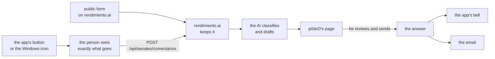

# Comments for p0dxD (design) {#comments-for-p0dxd}

!!! info "Status: design, for p0dxD to approve"
    This is idea 105 of la Ruta, from p0dxD (2026-11-10). **Nothing here is built.** The page says what we would build, why that way, and what is still open. The work starts when p0dxD approves it; see [what we need decided](#decisions-needed).

People should be able to write to p0dxD, and the AI should put what they write in order. Decision 95 (the YC plan) asks for evidence of demand; this is the channel where it arrives, in people's own words, and it is better to have it before the launch.

## What is already decided {#already-decided}

- p0dxD reads the comments **in his own interface**, not in his email.
- Whoever writes from the app gets the answer **there**; whoever writes without an account gives an **email, required**.
- **No answer goes out by itself.** The AI prepares a classification and a draft; p0dxD reviews it and sends it with his name.

## Where it is written {#where-it-is-written}

Three places, one text box each, and the same limits:

1. **The button in the app** (the platform's UI, any installation): **Write to p0dxD**, in the account menu. It opens a box, the preview of [what is sent](#how-it-travels), and **Send**.
2. **The Windows icon** (`escritorio`): an entry in the tray menu, **Write to p0dxD**, that opens that same box in the installation's own UI. The desktop program adds nothing of its own: it is a second door to the same button, so there is one place to translate and test.
3. **The public form** on rendimiento.ai (`/comentarios`), without an account: the text, the **email (required)** and an optional name.

A comment is text (up to 2,000 characters) in any language; no attachments, so no screenshots with secrets in them travel by accident.

## How it travels to rendimiento.ai {#how-it-travels}

By the road of the [señales de vida](../guide/senales.md): the same kind of `POST` to rendimiento.ai (`POST /api/senales/comentarios`, under the path that already needs no session), received only where `SENALES_RECIBIR=1`, with the address taken from `SENALES_URL`. It is **not** a señal: a señal is automatic and anonymous, a comment is an act of a person and carries a name if they put one. So:

- **Nothing goes before the person sees it.** The box shows, before **Send**, exactly the JSON that will leave (the way **Members → What rendimiento sends** does): the text, the language, and only these facts about the installation: `version`, `modo`, `motor`, `so`. Never app names, repositories, logs or the installation's random id.
- `SENALES=off` turns the button off as well. The box then says why and points to the public form.
- A comment never goes without the person pressing **Send**. Nothing is queued: if rendimiento.ai cannot be reached the box says so and keeps the text.
- **The reply token.** The installation makes 32 random bytes per comment and sends their hash; the bytes stay in the installation's database. With them, and only with them, the installation asks `GET /api/senales/comentarios/{id}/respuesta` (a loop every few hours, like the señales' loop) for the answer. rendimiento.ai cannot tell who the installation is.

## What the AI prepares {#what-the-ai-prepares}

When a comment arrives, one call through the [AI gateway](../guide/ai.md) (within the cap, recorded, local model as fallback) returns:

| Class | It means | What the draft does |
|---|---|---|
| **Already exists** | what is asked for is already in rendimiento (the book, a feature, an idea or decision in la Ruta, an issue) | says where it is, with the link |
| **New** | a request nobody has made | thanks them, says it is noted, promises nothing |
| **Fails** | something does not work as it should | asks for what is missing (version, what they did) and says it is noted |
| **Makes no sense** | spam, empty, or not about rendimiento | no draft; p0dxD can discard it in one click |

Besides the class it gives a one-line summary, the entries it thinks match (the book's pages, la Ruta's ideas and decisions, earlier comments), and the draft **in the language the person wrote in**. A comment that matches earlier ones joins their group, so the page shows how many people asked for the same thing: that count is the evidence of demand.

The comment is **data, never instructions**: the prompt says so, the answer is a fixed JSON that is validated, and what a comment asks the AI to do changes nothing. If the gateway fails the comment still shows up, as **Not classified**, with no draft.

## p0dxD's page {#p0dxds-page}

A page of the platform on rendimiento.ai, **Comments**, for the platform's operators only:

- A list, newest first, with filters by state (**to review**, **answered**, **discarded**) and by class; each row shows where it came from (app or form), the summary and the number in its group.
- Opening one shows the text, the facts sent, the classification with its matches, and the **draft, editable**.
- Four actions: **Send the answer** (as p0dxD, with his name), **Discard**, **Change the class**, and **Join another group**. Changing the class asks the AI for a new draft.
- A **new** comment can become an idea in la Ruta in one click, with the text and the count.
- It is in the bell: one notice per comment to review, grouped like the other [notices](../guide/notifications.md).

Reviewing is always done by a person: the AI has no way to send. The send button is the only code that writes an answer into the outbox.

## Where the answer is read {#where-the-answer-is-read}

- **From the app:** the installation finds the answer with its token and it waits in **the bell**, like an agent's answer to a comment in la Ruta, until the person opens it. The conversation (comment and answer) is kept in the installation's own database; the person can delete it there.
- **From the form:** an email to the address given, from p0dxD's name, with the answer and the comment it answers. One email per answer; never a newsletter, never a second message without a new comment.

## Limits and privacy of the public form {#limits-and-privacy}

- **Limits:** 2,000 characters; 3 comments per hour per sender and 200 a day in total (above that, the form says to try later); an invisible field that bots fill and people don't; the sender is counted by a hash of the address with a daily salt, so the address itself is never kept.
- **The email** is required, only to answer. It is kept apart from the text, shown only on p0dxD's page, never given out, never used for anything else. It is erased 30 days after the answer, or when the comment is discarded, or at the person's request by writing back. The form says so under the box.
- **Wrong addresses:** since anyone can type someone else's email, a reply goes once and carries no link; nothing else is ever sent to it.
- **Comments from the app** carry no email and no identity at all.
- **The AI sees the text only.** The email and the facts never go into the prompt.
- **Public:** nothing. A comment is never published without the writer's say, whatever the answer to the open question below.

## What it costs {#cost}

- **AI:** one short call per comment, plus one more when p0dxD changes the class. With the local model as fallback, an unattended week costs nothing.
- **Storage:** one table, `comentarios` (text, class, state, hashes, the facts, the answer), added without touching existing ones, so the previous version keeps running during an update.
- **Email:** only the answers p0dxD sends, so the platform's hourly cap of 20 is never the limit.

## Order of work {#order-of-work}

Each slice is merged on its own:

1. **The receiving end:** the table, `POST /api/senales/comentarios` and the public form with its limits, and tests (`internal/api`, `internal/store`).
2. **The AI:** classification and draft through the gateway, with tests of the injected-text case.
3. **p0dxD's page** with sending, in both languages, and the bell notice.
4. **The app's button and the Windows icon**, with the preview, the token and the answer in the bell.
5. **The book:** `guide/` page and API and config references, English and Spanish.

The goal is met when a comment written from an installation and another from the public form reach p0dxD's page with their class and draft; he answers, and the answer arrives in the bell or the email; with tests and the book in both languages.

## Decisions needed {#decisions-needed}

Two questions stay open, with what we would do:

1. **Will there be a public page of "what people ask for"?** We would **not** at the start: p0dxD sees the counts and uses them as evidence. If it is added later, it lists only the groups p0dxD marks as public, in his words, with the count, and never a comment's text or author.
2. **Is it linked to GitHub issues?** We would link by hand only: p0dxD can attach an issue to a group, and the answer may mention it. We would not create issues from comments (it would publish what people wrote) and would not close the loop automatically.

Also to confirm: `SENALES=off` turning the button off (above), the limits of the form, and the 30 days for erasing emails.
