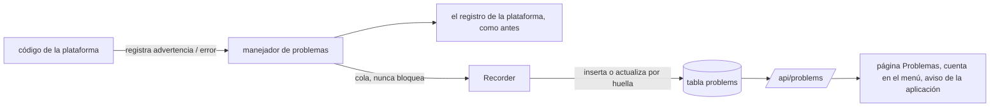

# Problemas

Cuando algo sale mal **dentro de rendimiento mismo**, aparece en la página **Problemas** (en la barra superior, con el número de problemas abiertos). Por ejemplo: un envío cuyo `rendimiento.yaml` fue rechazado, un correo de alerta que no se pudo enviar, una llamada a DNS o a GitHub que falló, un complemento que no se pudo sincronizar.

Las interrupciones de sus aplicaciones no son problemas: están en la [pestaña Confiabilidad](reliability.md) de cada aplicación.

## Lo que se ve {#what-you-see}

- Arriba, **contadores** de los problemas abiertos, los errores, las advertencias y los resueltos; al tocar uno se ven solo esos.
- A la izquierda, los problemas en una **lista por grupos**: primero los que **piden su atención** (abiertos), luego los **ya resueltos** y después los **anteriores** (descartados o que ya no están abiertos). Cada renglón tiene un punto de su color (rojo para un error, ámbar para una advertencia, verde cuando se resolvió), su mensaje y, debajo, dónde ocurrió (una aplicación o la plataforma) y cuántas veces.
- A la derecha, **el elegido** (el primero abierto, a menos que elija otro; la dirección lo conserva, así que al recargar se vuelve a ver): su **nivel**, dónde ocurrió y cuándo se resolvió, su mensaje como título, **Lo que pasó** (en palabras sencillas cuando rendimiento conoce el mensaje, el error que reportó cuando es una frase corta y cuántas veces ocurrió), **Qué hay que hacer** (para los mensajes cuyo significado se conoce; la mayoría dice si hay algo que hacer), su tira de 30 días y los botones: **Pedírselo a un agente** crea un encargo con lo que se registró, y **Descartar**. El error tal como se registró, la parte de la plataforma que lo reportó y sus demás valores quedan plegados en **Detalle técnico**.
- En el teléfono, la lista queda arriba y el elegido debajo.
- **Las repeticiones se agrupan.** El mismo problema que vuelve a ocurrir (aunque traiga otra confirmación u otro número) suma a su cuenta: *"40 veces desde las 2:10 p. m., la última hace 3 min"*. Una **tira de los últimos 30 días** enciende los días en que ocurrió (al pasar sobre un día se ve cuántas veces); la plataforma los cuenta por día (UTC) desde que se agregó esta tira, así que los problemas más viejos solo muestran su último día.
- Un problema sigue **abierto** durante 24 horas desde la última vez que ocurrió, a menos que antes se **resuelva** o se **descarte**:
    - **Resuelto** significa que rendimiento vio la prueba de que se corrigió, y dice cuál: un `rendimiento.yaml` rechazado se resuelve con el siguiente envío aceptado en la misma rama (*"corregido con c6eae54"*); un correo fallido, con el siguiente correo enviado; y una falla del trabajo que rendimiento reintenta por su cuenta (una App que el controlador vuelve a reconciliar, un candado que renueva, una llamada a GitHub o un ciclo que vuelve a correr), con 30 minutos sin volver a fallar (*"se volvió a intentar y no ha fallado en 30 minutos"*). Una falla que ocurre una sola vez, como una versión revertida, sigue abierta hasta que pasa su tiempo o se descarta.
    - **Descartar** oculta un problema a mano.
    - En cualquier caso, se vuelve a abrir si ocurre de nuevo.
- Los problemas se guardan durante **30 días** desde la última vez que ocurrieron.
- Los problemas de una aplicación también aparecen como un **aviso en la página de la aplicación**.

## Un `rendimiento.yaml` rechazado {#a-rejected-rendimientoyaml}

Si un envío trae un `rendimiento.yaml` que no se puede usar (un error de dedo, un host repetido), no se construye ni se publica nada, y la aplicación sigue ejecutando su versión actual. El envío de todos modos aparece:

- como una **ejecución fallida** en la pestaña Ejecuciones de la aplicación, cuya página dice por qué;
- como una **comprobación fallida** (✗ roja) en la confirmación en GitHub;
- en un **correo**, para la rama principal (vea [Notificaciones](notifications.md));
- en la página Problemas y en el aviso de la aplicación.

Corrija el archivo y envíelo de nuevo: en cuanto ese envío se acepta, el problema queda resuelto.

## Páginas que no se pudieron mostrar {#pages-that-could-not-be-shown}

Cuando una página de rendimiento no se puede mostrar, dice qué pasó, por qué pudo pasar y qué hacer, en vez de una pantalla en blanco o un error sin más:

- **Esta página no existe**: una dirección que ninguna página tiene, o una aplicación, ejecución o solicitud que no está. Sugiere una aplicación de nombre parecido cuando la hay, dice de qué página venía y ofrece *Ir a Aplicaciones* y *Atrás*.
- **No tiene acceso a esta página**: existe, pero su cuenta no tiene entrada. Dice en qué organización está usted.
- **Algo falló al mostrar esta página**: falló la propia interfaz. La barra superior y el menú se quedan; *Intentar de nuevo* vuelve a dibujar la página, y *Avisarle al equipo* abre [la página para escribirle al equipo](comentarios.md) con la página y un código corto ya escritos.
- **rendimiento no responde**: su conexión, o la plataforma actualizándose (menos de un minuto). Vuelve a intentar cada 5 segundos y regresa a la página cuando responde.

Cada una que se muestra se anota aquí una vez, agrupada por tipo y página, con la página de la que venía la persona y la versión de la interfaz (y, si una página falló, su error): *página no encontrada*, *página rechazada: sin acceso*, *una página falló al mostrarse*, *la interfaz no pudo comunicarse con rendimiento* (se anota cuando vuelve a responder). No se guarda quién la vio. Un enlace roto aparece aquí el mismo día: corrija el enlace o descarte el problema.

## Cómo funciona {#how-it-works}

- El registrador de la plataforma pasa cada registro a su salida normal; las advertencias y los errores **además** se ponen en cola para la página Problemas (`internal/problems`). Registrar nunca hace más lento al código que registra: si la cola está llena, los problemas se cuentan y se descartan.
- La **huella** de un problema es su nivel, su componente, su aplicación, su mensaje y su error, con los números y los hashes en blanco, para que las repeticiones caigan en una sola fila.
- Algunas advertencias se dejan fuera a propósito: los conflictos de escritura de Kubernetes que los controladores reintentan de inmediato, las aplicaciones caídas (de esas lleva la cuenta la pestaña Confiabilidad) el trabajo detenido por un apagado y las respuestas 5xx de la API que no son 500 (un servicio del que se depende caído, una página que esta computadora no tiene). Un 500 es un problema por ruta. Todo, sea problema o no, también está en [el registro](registro.md).
- API: `GET /api/problems` (`?app=`, `?dismissed=1`), `GET /api/problems/count`, `POST /api/problems/{id}/dismiss`; la interfaz informa sus páginas de error con `POST /api/fallas` (cada campo acotado, como máximo 20 avisos por sesión cada 10 minutos).
