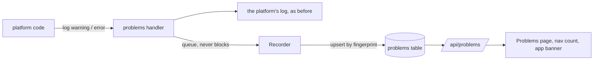

# Problems

When something goes wrong **inside rendimiento itself**, it shows up on the **Problems** page (in the top bar, with the number of open problems). Examples: a push whose `rendimiento.yaml` was rejected, an alert email that could not be sent, a DNS or GitHub call that failed, an add-on that would not sync.

Outages of your apps are not problems: they're on each app's [Reliability tab](reliability.md).

## What you see

- At the top, **counters** for the open problems, the errors, the warnings and the resolved ones; pressing one shows only those.
- Each problem has its **level** (warning or error), its **message** and the error it reported, the **app** it concerns (if any), and the **part of the platform** that reported it.
- **Repeats are grouped.** The same problem happening again (even with a different commit or number in it) adds to its count: *"40 times since 2:10 PM, last 3 min ago"*. A **strip of the last 30 days** lights up the days it happened (hover a day for how many times); the platform counts them by day (UTC) since this page was added, so older problems show only their last day.
- A problem is **open** for 24 hours after it last happened, unless it is **resolved** or **dismissed** first:
    - **Resolved** means rendimiento saw proof it's fixed, and says what: a rejected `rendimiento.yaml` is resolved by the next push accepted on the same branch (*"fixed by c6eae54"*), a failed email by the next email sent, and a failure of work rendimiento retries by itself (an App the controller reconciles again, a lease it renews, a call to GitHub or a loop that runs again) by 30 minutes without failing again (*"it was tried again and has not failed for 30 minutes"*). A failure that happens once, such as a release rolled back, stays open until it ages out or is dismissed.
    - **Dismiss** hides a problem by hand.
    - Either way, it reopens if it happens again.
- Problems are kept for **30 days** after they last happened.
- Problems about an app also appear as a **banner on the app's page**.

## A rejected `rendimiento.yaml`

If a push has a `rendimiento.yaml` that cannot be used (a typo, a host listed twice), nothing is built or released, and the app keeps running its current release. The push still shows up:

- as a **failed run** on the app's Runs tab, whose page says why;
- as a **failed check** (red ✗) on the commit in GitHub;
- in an **email**, for the default branch (see [Notifications](notifications.md));
- on the Problems page and the app's banner.

Fix the file and push again: once that push is accepted, the problem is marked resolved.

## Pages that could not be shown

When a page of rendimiento cannot be shown, it says what happened, why it may have, and what to do, instead of a blank screen or a bare error:

- **This page does not exist**: an address no page has, or an app, run or request that is not there. It suggests an app with a close name when there is one, says which page you came from, and offers *Go to Apps* and *Back*.
- **You have no access to this page**: it exists, but your account has no entry to it. It says which organization you are in.
- **Something failed showing this page**: the interface itself failed. The top bar and menu stay; *Try again* draws the page again, and *Tell the team* opens [the page for writing to the team](comentarios.md) with the page and a short code already written.
- **rendimiento does not answer**: your connection, or the platform updating (under a minute). It tries again every 5 seconds and comes back to the page when it answers.

Each one shown is recorded here once, grouped by kind and page, with the page the person came from and the interface's version (and, for a page that failed, its error): *page not found*, *page refused: no access*, *a page failed to show*, *the UI could not reach rendimiento* (recorded once it answers again). Who saw it is not kept. A broken link shows here the same day: fix the link, or dismiss the problem.

## How it works

- The platform's logger passes every record to its normal output; warnings and errors are **also** queued for the Problems page (`internal/problems`). Recording never slows the code that logs: if the queue is full, problems are counted and dropped.
- The **fingerprint** of a problem is its level, component, app, message and error, with numbers and hashes blanked, so repeats land on one row.
- Some warnings are left out on purpose: Kubernetes write conflicts that the controllers retry immediately, apps going down (the Reliability tab tracks those), and work stopped by a shutdown.
- API: `GET /api/problems` (`?app=`, `?dismissed=1`), `GET /api/problems/count`, `POST /api/problems/{id}/dismiss`; the interface reports its error pages with `POST /api/fallas` (every field bounded, at most 20 reports per session in 10 minutes).
