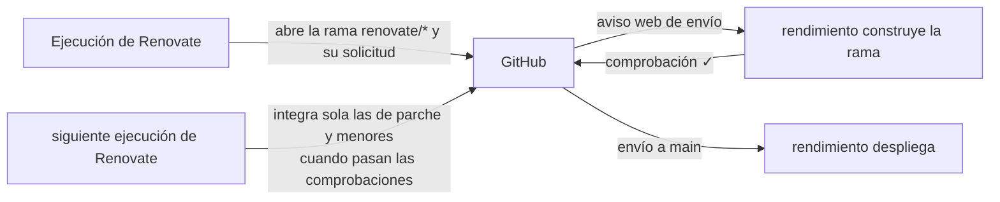

# Renovate

[Renovate](https://docs.renovatebot.com) mantiene las dependencias al día: encuentra actualizaciones (npm, pip, módulos de Go, Maven, imágenes base de Docker, versiones de paquetes de Helm en Ansible…) y abre una solicitud de incorporación por cada una. rendimiento lo ejecuta como un **complemento integrado** (`internal/renovate`).

## Cómo se ejecuta {#how-it-runs}

- Según una **programación** (cron, en UTC; de forma predeterminada `0 5 * * *`) o con **Ejecutar ahora**.
- Cada ejecución es un pod en el espacio de nombres aislado de construcción, con un **token nuevo de la aplicación de GitHub** válido por una hora. No hay ningún token personal que pueda vencer o filtrarse.
- Las confirmaciones y las solicitudes vienen del bot de la aplicación (`<nombre-de-la-aplicación>[bot]`) y se firman a través de la API de GitHub (confirmaciones verificadas).
- Cubre cada aplicación que tiene encendido su interruptor de **Actualizaciones de dependencias** (en la página de la aplicación o en la de Complementos), más los **otros repositorios** que aparecen en la configuración (por ejemplo `p0dxD/main_configs`).
- Su **configuración** (`config.js`) se edita en la página Complementos; rendimiento pone por su cuenta el token, los repositorios y la identidad.
- Cada ejecución registra, por repositorio, el resultado, las solicitudes abiertas, las integradas y los errores, más un registro legible. El nivel de registro se puede poner en *debug* para ver por qué pasó algo.

## El ciclo con la integración continua {#the-loop-with-ci}

La configuración actual integra sola las actualizaciones **de parche y menores** en cuanto pasan las comprobaciones de rendimiento, excepto las etiquetas **menores y mayores de Docker** (un nuevo entorno de ejecución del lenguaje puede romper las construcciones) y las **menores y mayores de SQLAlchemy** (la 2.1 cambió el controlador predeterminado de Postgres). Las actualizaciones mayores siempre lo esperan a usted. Los repositorios sin una aplicación en rendimiento (como `main_configs`) no tienen comprobación de construcción. Una actualización de una carpeta que ningún paso construye ni prueba (una app `mobile/` sin paso propio) recibe una comprobación *Action required* en lugar de una en verde, así que Renovate la deja para una persona: vea [Lo que ningún paso prueba](builds.md#what-no-step-tests).

!!! warning "Que se construya no significa que funcione"
    En las aplicaciones sin pruebas, la comprobación solo demuestra que la imagen se construye. Una actualización todavía puede descomponerse al ejecutarse, como le habría pasado a wellness con SQLAlchemy 2.1. Agregue pruebas, o excluya de la integración automática los paquetes riesgosos en la configuración.

Cada actualización lleva además un informe en la pestaña Caminos de la aplicación: qué fallaría, qué cambiaría y cuánto, y un botón para que un agente adapte la aplicación a ella. Vea [Poner una aplicación al día](al-dia.md).

## Permisos necesarios de la aplicación de GitHub {#required-github-app-permissions}

La primera petición de Renovate para cada repositorio lee sus incidencias (el panel de dependencias), así que la aplicación necesita **Issues: lectura y escritura** y **Commit statuses: solo lectura**, además de contenido, solicitudes de incorporación y comprobaciones. La página Complementos enumera lo que falte y lleva adonde se otorga; las ejecuciones no empiezan hasta que la instalación lo acepta.

Con solo lectura de los estados de confirmación, rendimiento le indica a Renovate que no ponga los suyos (`renovate/artifacts`, `renovate/stability-days`, `renovate/merge-confidence`, `renovate/config-validation`): ponerlos falla, y entonces Renovate abandona todo el repositorio como `repository-changed`. Lo que decide una integración son las comprobaciones de rendimiento. Una instalación con **Commit statuses: lectura y escritura** conserva los estados de Renovate.

## GitLab y Bitbucket {#gitlab-and-bitbucket}

También se cubren las aplicaciones de [GitLab](gitlab.md) o de [Bitbucket](bitbucket.md) que tengan el interruptor encendido: cada conexión tiene su propio pod, con `platform` en `gitlab` (y la API de ese GitLab como `endpoint`) o en `bitbucket`, y la ficha OAuth de la conexión, que se renueva antes si no alcanzaría para toda la ejecución. Renovate confirma con git y abre solicitudes de fusión (solicitudes de incorporación en Bitbucket) como la cuenta que autorizó la conexión; rendimiento las construye y las comprueba como cualquier otra rama, y les aplica igual los [arreglos declarados](fixes.md) de la aplicación. Los **otros repositorios** de los ajustes son de GitHub.

## Archivos de bloqueo {#lockfiles}

Cuando Renovate cambia una dependencia también regenera el archivo de bloqueo que la acompaña (`package-lock.json`, `yarn.lock`, `pnpm-lock.yaml`, `poetry.lock`, `go.sum`…): la imagen de Renovate instala dentro del pod la herramienta adecuada (node y npm, Python y Poetry…) cuando la necesita y la ejecuta ahí. Para eso el pod no necesita más de lo que el espacio de nombres de construcción ya permite: internet (los registros de paquetes y las descargas de las herramientas) y un `/tmp` en el que se pueda escribir.

Si la herramienta falla (un conflicto de dependencias entre pares, una versión que no existe, un registro privado al que el pod no llega), Renovate abre de todos modos la solicitud de incorporación con solo el manifiesto cambiado, y comenta en ella el error de la herramienta bajo *Artifact update problem*. La construcción de la aplicación falla entonces con el archivo de bloqueo desactualizado (`npm ci`: *lock file … does not satisfy …*). rendimiento guarda cada uno de esos errores:

- en los resultados de la ejecución, por repositorio (`artifactErrors`: rama, archivo y las líneas de error de la herramienta), que se muestran bajo la ejecución en la página Complementos y en la página de la aplicación;
- en la página **Problemas**, como *Renovate no pudo actualizar un archivo de bloqueo*, con la aplicación, el repositorio, la rama y el archivo.

Corrija la causa en el repositorio de la aplicación y después marque la casilla de reintento (*rebase/retry*) en la solicitud de incorporación (o en el panel de dependencias): Renovate no vuelve a intentar por sí solo el archivo de bloqueo de una rama hasta que el manifiesto necesite otro cambio.

**Con un arreglo declarado, rendimiento lo regenera por su cuenta.** Cuando la ejecución de una rama de Renovate falla por un archivo de bloqueo desactualizado y la aplicación declara una [receta](fixes.md#recipes) cuya carpeta contiene la del paso que falló (`fixes:` en el `rendimiento.yaml` de la rama principal), rendimiento corre la receta en la rama y guarda ahí el archivo de bloqueo en una confirmación; la ejecución nueva decide. Lo intenta una vez por confirmación, nunca en una confirmación que hizo un arreglo (así no puede dar vueltas sin fin), y solo con recetas, nunca con un comando propio de la aplicación. Una rama cuenta como de Renovate cuando se llama `renovate/…` y su solicitud de incorporación, si la tiene, la abrió un bot desde el mismo repositorio. Renovate puede ver entonces una confirmación ajena en su rama y dejar de reorganizarla (rebase), como con cualquier rama editada; marque la casilla de reintento cuando quiera de vuelta la versión de Renovate.

## Ramas que dejó un Renovate anterior {#branches-left-by-an-earlier-renovate}

Renovate solo toca las ramas que creó su propia identidad. Las ramas de una configuración anterior (con un token personal) aparecen como *editadas por alguien más*: se omiten **y aun así** cuentan para el límite de ramas abiertas, lo que puede detener todas las solicitudes nuevas. Elimínelas (sus confirmaciones se pueden recuperar con sus SHA), o agregue `ignorePrAuthor: true` y `gitIgnoredAuthors: [<correo del autor anterior>]` a la configuración para adoptarlas.
