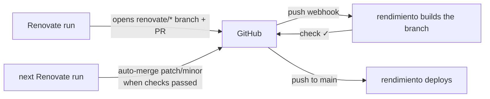

# Renovate

[Renovate](https://docs.renovatebot.com) keeps dependencies up to date: it finds updates (npm, pip, Go modules, Maven, Docker base images, Helm chart versions in Ansible…) and opens a pull request for each. rendimiento runs it as a **built-in add-on** (`internal/renovate`).

## How it runs

- On a **schedule** (cron, in UTC; default `0 5 * * *`) or with **Run now**.
- Each run is a pod in the isolated build namespace, with a **fresh GitHub App token** valid for an hour. There is no personal token to expire or leak.
- Commits and PRs come from the App's bot (`<app-name>[bot]`) and are signed through GitHub's API (verified commits).
- It covers every app whose **Dependency updates** switch is on (on the app's page or the Add-ons page), plus **other repositories** listed in the settings (e.g. `p0dxD/main_configs`).
- Its **config** (`config.js`) is edited on the Add-ons page; rendimiento sets the token, repositories and identity itself.
- Each run records, per repository, the result, PRs opened, PRs merged and errors, plus a readable log. The log level can be set to *debug* to see why something happened.

## The loop with CI

The current configuration auto-merges **patch and minor** updates once rendimiento's checks pass, except **Docker minor/major** tags (a new language runtime can break builds) and **SQLAlchemy minor/major** (2.1 changed the default Postgres driver). Major updates always wait for you. Repositories without a rendimiento app (like `main_configs`) have no build check. An update to a folder no step builds or tests (a `mobile/` app with no step of its own) gets an *Action required* check instead of a green one, so Renovate leaves it for a person: see [What no step tests](builds.md#what-no-step-tests).

!!! warning "A passing build is not a passing app"
    For apps without tests, the check only proves the image builds. An update can still break at runtime, as SQLAlchemy 2.1 would have for wellness. Add tests, or exclude risky packages from auto-merge in the config.

Each update also gets a report on the app's Caminos tab: what would fail, what would change and how much, and a button that has an agent adapt the app to it. See [Putting an app up to date](al-dia.md).

## Required GitHub App permissions

Renovate's first request for each repository reads its issues (the Dependency Dashboard), so the App needs **Issues: Read and write** and **Commit statuses: Read-only** in addition to contents, pull requests and checks. The Add-ons page lists anything missing and links to where to grant it; runs do not start until the installation has accepted it.

With only read access to commit statuses, rendimiento tells Renovate not to set its own (`renovate/artifacts`, `renovate/stability-days`, `renovate/merge-confidence`, `renovate/config-validation`): setting one fails, and Renovate then abandons the whole repository as `repository-changed`. rendimiento's own checks are what gate a merge. An installation granted **Commit statuses: Read and write** keeps Renovate's statuses.

## GitLab and Bitbucket {#gitlab-and-bitbucket}

Apps on [GitLab](gitlab.md) or [Bitbucket](bitbucket.md) with the switch on are covered too: each connection gets a pod of its own, with `platform` set to `gitlab` (and the GitLab's API as `endpoint`) or `bitbucket`, and the connection's OAuth token, refreshed first when it would not last the run. Renovate commits with git and opens merge requests (pull requests on Bitbucket) as the account that authorized the connection; rendimiento builds and checks them like any other branch, and runs the app's [declared fixes](fixes.md) on them the same way. **Other repositories** in the settings are GitHub's.

## Lockfiles

When Renovate changes a dependency it also regenerates the lockfile beside it (`package-lock.json`, `yarn.lock`, `pnpm-lock.yaml`, `poetry.lock`, `go.sum`…): the Renovate image installs the right tool (node and npm, Python and Poetry…) inside the pod as it needs it and runs it there. For that the pod needs nothing more than the build namespace already allows: the internet (the package registries and the tools' downloads) and a writable `/tmp`.

If the tool fails (a peer-dependency conflict, a version that does not exist, a private registry the pod cannot reach), Renovate still opens the pull request with only the manifest changed, and comments the tool's error on it under *Artifact update problem*. The app's build then fails on the stale lockfile (`npm ci`: *lock file … does not satisfy …*). rendimiento keeps each such error:

- in the run's results, per repository (`artifactErrors`: branch, file and the tool's error lines), shown under the run on the Add-ons page and on the app's page;
- on the **Problems** page, as *Renovate could not update a lockfile*, with the app, repository, branch and file.

Fix the cause in the app's repository, then tick the rebase/retry box in the pull request (or in the Dependency Dashboard): Renovate does not retry a branch's lockfile by itself until the manifest needs another change.

**With a declared fix, rendimiento regenerates it itself.** When a Renovate branch's run fails on a stale lockfile and the app declares a [recipe](fixes.md#recipes) whose folder holds the failed step's (`fixes:` in the default branch's `rendimiento.yaml`), rendimiento runs the recipe on the branch and commits the lockfile there; the new run decides. It tries once a commit, never on a commit a fix made (so it cannot loop), and only with recipes, never with a command of the app's own. A branch counts as Renovate's when it is named `renovate/…` and its pull request, if it has one, was opened by a bot from the repository itself. Renovate may then see someone else's commit on its branch and stop rebasing it, as it does for any edited branch; tick the rebase box when you want Renovate's own version back.

## Branches left by an earlier Renovate

Renovate only touches branches its own identity created. Branches from an earlier setup (a personal token) look *edited by someone else*: they are skipped **and** still count toward the limit on open branches, which can stop all new PRs. Delete them (their commits can be restored from their SHAs), or add `ignorePrAuthor: true` and `gitIgnoredAuthors: [<old author email>]` to the config to adopt them.
