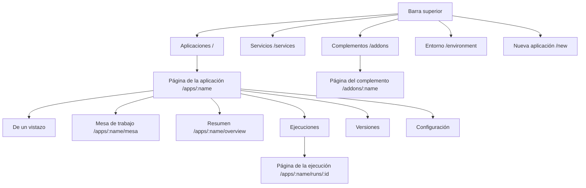

# Un recorrido por la interfaz

El panel está en **https://rendimiento.example.com**. Se entra con GitHub; solo pasan los [miembros](../guide/members.md), cada uno con su función. La barra superior tiene cinco lugares: **Aplicaciones**, **Servicios**, **Complementos**, **Entorno** y el botón **Nueva aplicación**.

## Aplicaciones {#apps}

La página de inicio enumera cada aplicación con su fase (*Saludable*, *En curso*, *Degradado*, *Esperando la primera construcción*…), su última ejecución y sus direcciones públicas. Las fases se actualizan en vivo.

## Nueva aplicación {#new-app}

Una sola pantalla, en tres movimientos:

1. **Repositorio**: a la izquierda, cada repositorio que la aplicación de GitHub puede ver, con un filtro. Al elegir uno se ejecuta la detección sobre él. Si aún no tiene qué desplegar, la página (y la de Aplicaciones cuando está vacía) enlaza **el ejemplo**, [rendimiento-ai/hola](https://github.com/rendimiento-ai/hola): una página servida por nginx, que GitHub copia a su cuenta.
2. **Configurar**: a la derecha, el nombre de la aplicación y un renglón por cada servicio detectado: URL pública (subdominio más zona), tamaño, instancias y **Necesidades** (PostgreSQL, Redis). **Más opciones** despliega el formulario completo de cada servicio: puerto, comprobación de estado, almacenamiento, secretos, pruebas, variables de entorno y necesidades (también otro servicio elegido del catálogo; vienen marcadas cuando el código usa una biblioteca cliente para ellas). Si el repositorio no tiene Dockerfile, usted elige entre **construir desde el código fuente** (Railpack, lo recomendado) y **agregar un Dockerfile generado**. Si ya hay algo en ejecución en el espacio de nombres de destino (desplegado con ArgoCD o a mano), un panel de migración ofrece **asumir su control** en su lugar.
3. **Desplegar**: para un repositorio nuevo, rendimiento abre una solicitud de incorporación que agrega `rendimiento.yaml` (y un Dockerfile si eligió uno); la solicitud se construye y se comprueba, e **integrarla despliega**. Para un repositorio que ya tiene `rendimiento.yaml`, la primera construcción empieza de inmediato.

## La página de la aplicación {#the-app-page}

**De un vistazo**
:   Lo que la mayoría necesita, y lo primero que se abre: un cempasúchil abierto y respirando mientras la aplicación corre, que cierra sus pétalos cuando va lenta o falla a veces y se marchita cuando no responde (un brote verde antes de su primera versión). Un colibrí revolotea mientras un agente trabaja en la aplicación. A un lado, una frase del [resumen del día](../guide/ai.md#the-days-summary), cuánto de la semana estuvo en línea (un anillo), un punto por cada día de la semana (verde, ámbar cuando estuvo lenta, rojo cuando no respondió un rato), sus visitas de los últimos siete días en barras y contra la semana anterior, qué tan rápido responde y cuántos cambios tuvo la semana. **Para usted** aparece solo cuando algo necesita a una persona: una publicación que falló, trabajo de los agentes que espera revisión. **Ver los detalles** lleva a la mesa de trabajo; **Mostrarme lo técnico primero** hace que en este dispositivo se abra primero la mesa. Con el movimiento apagado, la flor, el colibrí y las barras se quedan quietos.

**Mesa de trabajo**
:   Todo lo abierto de la aplicación, en una lista: cada línea de trabajo es una rama con su solicitud de integración, su última ejecución y los encargos sobre ella (o un encargo sin rama), con lo que necesita y un enlace para hacerlo. **Le toca a usted**: una rama que pasó y se puede integrar (o que GitHub no deja integrar sin una revisión), una que choca con la rama principal, una que falló y nadie tiene, una solicitud abierta que nunca se probó aquí, y el trabajo que un agente entregó para su revisión. **Trabajando**: una ejecución en curso, o un agente que tiene el encargo. **Sobra: se puede cerrar**: una solicitud abierta con la misma confirmación que otra (la original es la más vieja, o la que ya entró), y una rama que falló hace más de una semana sin solicitud. **Entró hoy**: lo que se integró en el último día. Una línea que sobra tiene **Cerrar** (la solicitud se cierra sin integrar y su rama se borra) o **Borrar la rama**; pregunta antes, y rendimiento nunca lo hace solo. El inicio dice cuántas cosas esperan su atención en cada aplicación, con el enlace a su mesa. Los agentes leen la misma mesa con `mesa_leer` antes de abrir una rama.

**Resumen**
:   Una tarjeta por servicio: réplicas listas, URL pública, estado del DNS y del certificado, y la imagen en ejecución. **Provisto para esta aplicación** muestra la base de datos y la caché de `needs:`, qué servicios las usan y cómo conectarse desde su computadora. **Actualizaciones de dependencias** es el interruptor de Renovate por aplicación. **Recursos** es un árbol en vivo de los objetos de Kubernetes (Deployments, pods, Services, Ingresses) con su salud.

**Ejecuciones**
:   Cada ejecución de integración continua: confirmación, rama, estado y duración. **Construir ahora** inicia a mano una construcción de la rama principal. Arriba de la lista, filtros por [tipo de rama](../guide/builds.md#kinds-of-branch): la rama principal, con solicitud de incorporación, arreglos, funciones, versiones, dependencias y otras ramas.

**Página de la ejecución**
:   Los pasos de la ejecución en una lista, cada uno con una barrita de cuándo corrió (las que se enciman corrieron «a la par»: pruebas antes de las construcciones, servicios en paralelo), con su registro en vivo, su duración y, para las construcciones, la huella de la imagen y el demonio de BuildKit que la construyó. Los pasos reutilizados muestran de qué versión vienen.

**Versiones**
:   Cada versión con su confirmación y sus imágenes; **Revertir** a cualquiera de ellas.

**Configuración**
:   Defina los valores de los secretos que declara la aplicación (nunca van a git), y la **Zona de peligro**: *Desconectar* (dejar de administrarla y dejar todo en ejecución) o *Eliminar* (después de mostrar exactamente qué se quitaría: espacio de nombres, volúmenes, secretos).

## Servicios {#services}

Cada Service del clúster, en una lista a la izquierda con tres grupos:

- **Sus aplicaciones y complementos**: lo que despliega rendimiento;
- **En otras partes del clúster**: desplegado con ArgoCD, Helm o `kubectl`;
- **Interior del clúster**: entrada, certificados, almacenamiento, integración continua.

Dentro de cada grupo, los servicios se ordenan por lo que hacen: Bases de datos, Cachés y colas, IA, Almacenamiento, Monitoreo y analítica, Web y API, Herramientas de desarrollo, Plataforma, cada uno con un punto que dice si está listo. La búsqueda abarca todos los grupos. Elija un servicio y a la derecha verá **de dónde viene** (aplicación, carpeta del repositorio, imagen, aplicación de ArgoCD o instalación de Helm), **qué expone** (puertos, URL públicas, dirección en la red local, comprobación de estado, rutas), **cómo conectarse** (direcciones y un fragmento de `rendimiento.yaml` para copiar) y **quién lo usa** (encontrado en las variables de entorno de otras cargas de trabajo).

## Complementos {#add-ons}

Una lista a la izquierda, con una caja de búsqueda sobre toda ella, y el complemento elegido a la derecha.

- **Pide atención** e **Instalados**: cada complemento instalado con su fase (*Sincronizado*, *Cambios pendientes*, *Requiere revisión*, *Error*, *Suspendido*) y su origen (los que están en *Error*, *Requiere revisión* o *Cambios pendientes* van primero, en *Pide atención*). Al elegir uno se ve lo que cambiaría una sincronización, objeto por objeto con sus diferencias; sus ganchos de Helm y sus ejecuciones recientes; y los botones para **Sincronizar**, **Suspender**, **Editar la definición**, **Dejar de administrar** o **Desinstalar**.
- **Agregar desde el catálogo**: Longhorn, Hajimari, Uptime Kuma, CloudNativePG, *cualquier paquete de Helm* o *manifiestos desde una carpeta de git*; al elegir uno se abre su formulario corto, con una caja de YAML para sobrescribir cualquier valor del paquete. Instalar confirma un archivo en el repositorio de gitops.
- **Integrados**: Renovate, con su programación, sus repositorios, su configuración y su historial de ejecuciones.

## Entorno {#environment}

Todo aquello de lo que depende rendimiento, comprobado en vivo y dibujado como un pueblo de Cotija:

- **El bando**: la versión de rendimiento que corre y, cuando hay una más nueva lista, el sello **Actualizar**.
- **La calle**: cada nodo es una casa (el plano de control es la parroquia, con sus dos torres). Las ventanas encendidas dicen qué tan ocupado está su procesador, el guardapolvo rojo sube con su memoria y un papelito en la puerta avisa que algo anda mal. Toque una casa para ver su CPU, su memoria, sus condiciones y sus roles.
- **Los letreros**: los proveedores (clúster, DNS, código fuente, registro) y algunos requisitos (correo, almacenamiento, la base de datos) cuelgan sobre la plaza. Un letrero abre su *ventanilla*: el proveedor en uso y los que vienen; para el DNS, la IP pública, cuándo cambió por última vez y un botón *Actualizar ahora*; para el correo, *Enviar un correo de prueba*; y los detalles y la **solución** cuando algo está mal.
- **Avisos en la plaza**: un tablero de corcho con cada requisito que pide atención y cada pod o certificado con fallas.
- **Lo que el pueblo necesita**: las comprobaciones agrupadas (clúster, red, TLS, construcción, integraciones), cada una *Correcto*, *Atención*, *Ausente* o *Error*, con detalles y una **solución** cuando algo está mal. Por ejemplo: el controlador de entrada, cert-manager y su emisor, las clases de almacenamiento, el grupo de BuildKit (cuántos demonios están listos), el registro, el aislamiento del espacio de nombres de construcción y la aplicación de GitHub.

## Configuración inicial {#setup}

La primerísima visita, antes de que exista una aplicación de GitHub, muestra la configuración en un clic: rendimiento le envía a GitHub el *manifiesto* de una aplicación, GitHub crea la aplicación y regresa con sus credenciales, que se guardan en un secreto de Kubernetes. Vea [Cómo se despliega la plataforma](../environment/deploy.md#the-github-app).
