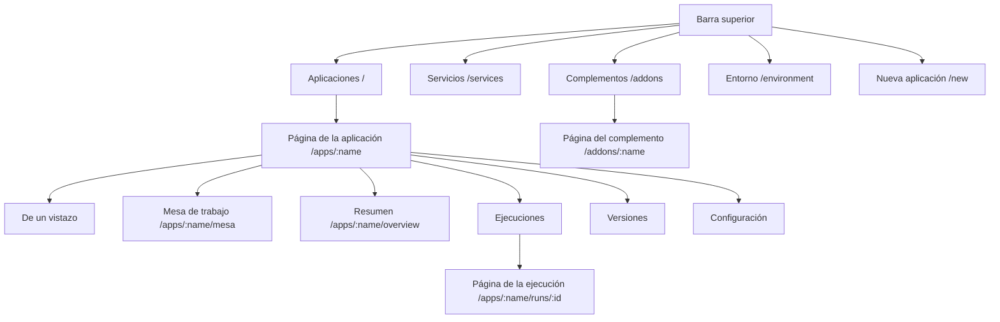

# Un recorrido por la interfaz

El panel está en **https://rendimiento.example.com**. Se entra con GitHub; solo pasan los [miembros](../guide/members.md), cada uno con su función. La barra superior tiene dos renglones: arriba el buscador, la campana, **Nueva aplicación** y su cuenta; abajo, todas las páginas ([La barra superior](#top-bar)).

La franja al pie de cada página dice qué rendimiento contesta, a cualquiera con sesión: su versión (o la confirmación de la que se construyó), el sistema para el que es su programa, y si corre en una computadora o en un clúster de Kubernetes, como en `v0.2.1 · Linux arm64 · en una computadora`. Dé esa línea cuando reporte algo.

## La barra superior {#top-bar}

En una pantalla ancha, el primer renglón tiene la marca, el **buscador**, la campana, **Nueva aplicación** (administradores) y su **cuenta** (su inicial y su usuario). El segundo renglón tiene todas las páginas que puede abrir, cada una con su dibujo: Aplicaciones, Universo, Servicios y Complementos (operadores, en un clúster), Entorno, Ruta, Bitácora (no invitados), IA, Problemas con cuántos hay abiertos (operadores) y Comentarios.

- **El buscador** encuentra, mientras escribe, aplicaciones por su nombre o su repositorio, ejecuciones por su número o su rama (entre las últimas de sus aplicaciones, o cualquier número que escriba) y páginas por su nombre, en su idioma y con o sin acentos. Pulse **/** en cualquier página para ir a él (no mientras escribe en una caja), las flechas para moverse, **Intro** para abrir el primer resultado y **Escape** para vaciarlo y cerrarlo. El buscador de la página Aplicaciones sigue filtrando el mosaico.
- **El menú de su cuenta** tiene quién es usted (abre Miembros), la **organización** (una lista cuando pertenece a más de una), el **tema** (día o noche, la familia de colores y el movimiento), el **idioma** y la bandera, **Mis comentarios** (lo que le escribió al equipo y sus respuestas) y **Cerrar sesión**. Escape o un clic afuera lo cierra; las flechas se mueven entre sus renglones.

En un teléfono la barra es un solo renglón corto: la marca, un botón de búsqueda que abre la caja sobre la parte de arriba de la pantalla, la campana y su inicial. Las páginas y la cuenta están en la hoja que asoma desde abajo.

## Aplicaciones {#apps}

La página de inicio enumera cada aplicación con su fase (*Saludable*, *En curso*, *Degradado*, *Esperando la primera construcción*…), su última ejecución y sus direcciones públicas. Las fases se actualizan en vivo.

Arriba, **Corriendo ahora** tiene una tarjeta por cada ejecución en cola o en curso: su aplicación (abre la aplicación), su rama, sus pasos como barritas (pasó, en curso, falló, por venir), el paso de ahora y cuánto lleva, y **Ver la ejecución N →**. Se actualiza sola. Cuando nada corre es una sola línea, **Todo en calma**, con la última ejecución que terminó.

## Nueva aplicación {#new-app}

Una sola pantalla, en tres movimientos:

1. **Repositorio**: a la izquierda, cada repositorio que la aplicación de GitHub puede ver, con un filtro. Al elegir uno se ejecuta la detección sobre él. Si aún no tiene qué desplegar, la página (y la de Aplicaciones cuando está vacía) enlaza **el ejemplo**, [rendimiento-ai/hola](https://github.com/rendimiento-ai/hola): una página servida por nginx, que GitHub copia a su cuenta.
2. **Configurar**: a la derecha, el nombre de la aplicación y un renglón por cada servicio detectado: URL pública (subdominio más zona), tamaño, instancias y **Necesidades** (PostgreSQL, Redis). **Más opciones** despliega el formulario completo de cada servicio: puerto, comprobación de estado, almacenamiento, secretos, pruebas, variables de entorno y necesidades (también otro servicio elegido del catálogo; vienen marcadas cuando el código usa una biblioteca cliente para ellas). Si el repositorio no tiene Dockerfile, usted elige entre **construir desde el código fuente** (Railpack, lo recomendado) y **agregar un Dockerfile generado**. Si ya hay algo en ejecución en el espacio de nombres de destino (desplegado con ArgoCD o a mano), un panel de migración ofrece **asumir su control** en su lugar.
3. **Desplegar**: para un repositorio nuevo, rendimiento abre una solicitud de incorporación que agrega `rendimiento.yaml` (y un Dockerfile si eligió uno); la solicitud se construye y se comprueba, e **integrarla despliega**. Para un repositorio que ya tiene `rendimiento.yaml`, la primera construcción empieza de inmediato.

## La página de la aplicación {#the-app-page}

**De un vistazo**
:   Lo que la mayoría necesita, y lo primero que se abre. Su encabezado, a lo ancho de la tarjeta: un cempasúchil abierto y respirando mientras la aplicación corre, que cierra sus pétalos cuando va lenta o falla a veces y se marchita cuando no responde (un brote verde antes de su primera versión); un colibrí revolotea mientras un agente trabaja en la aplicación. A un lado, su estado en una palabra, una frase del [resumen del día](../guide/ai.md#the-days-summary), las direcciones donde responde la aplicación (cada una un enlace), qué tan rápido responde, cuántos cambios tuvo la semana y cuánto de la semana estuvo en línea, y los botones **Construir ahora** (no para los invitados) y **Ver ejecuciones**. Debajo, tres columnas, lado a lado en una pantalla ancha y una bajo otra en un teléfono. **Ahora**: cada ejecución que corre para la aplicación, con su rama, sus pasos como barritas, el paso en que va y cuánto lleva, y un enlace a ella (o una línea discreta cuando no corre nada); luego **Esperan su atención**: una publicación que falló y las líneas de *Le toca a usted* de la mesa de trabajo (una solicitud de cambios que pasó o falló, un conflicto, trabajo de los agentes que espera revisión), cada una una puerta a la mesa. **Esta semana**: un punto por día (verde, ámbar cuando estuvo lenta, rojo cuando no respondió un rato) con una línea sobre el peor día, y sus visitas de los últimos siete días en barras, con los visitantes y cómo se comparan con la semana anterior. **Lo último** es su diario: ejecuciones, versiones y encargos con la hora, y el día en que nació; debajo, mientras le faltan números (aún sin revisiones de disponibilidad, visitas apagadas, sin copias de vista previa), tarjetas con los pasos que los traen, y cada una se va cuando se cumple. Los nombres de las ramas, aquí y en las demás pestañas, son enlaces a la rama en GitHub. **Ver los detalles** lleva a la mesa de trabajo; **Mostrarme lo técnico primero** hace que en este dispositivo se abra primero la mesa. Con el movimiento apagado, la flor, el colibrí y las barras se quedan quietos.

**Mesa de trabajo**
:   Todo lo abierto de la aplicación, en una lista: cada línea de trabajo es una rama con su solicitud de integración, su última ejecución y los encargos sobre ella (o un encargo sin rama), con lo que necesita y un enlace para hacerlo. **Le toca a usted**: una rama que pasó y se puede integrar (o que GitHub no deja integrar sin una revisión), una que choca con la rama principal, una que falló y nadie tiene, una solicitud abierta que nunca se probó aquí, y el trabajo que un agente entregó para su revisión. **Trabajando**: una ejecución en curso, o un agente que tiene el encargo. **Sobra: se puede cerrar**: una solicitud abierta con la misma confirmación que otra (la original es la más vieja, o la que ya entró), y una rama que falló hace más de una semana sin solicitud. **Entró hoy**: lo que se integró en el último día. Una línea que sobra tiene **Cerrar** (la solicitud se cierra sin integrar y su rama se borra) o **Borrar la rama**; pregunta antes, y rendimiento nunca lo hace solo. El inicio dice cuántas cosas esperan su atención en cada aplicación, con el enlace a su mesa. Arriba, **¿Qué le cambiamos?** convierte lo que usted escribe en un encargo sobre la aplicación (su primera línea es el título), con ideas a un toque; de ahí lo toma un agente. Los agentes leen la misma mesa con `mesa_leer` antes de abrir una rama.

**Resumen**
:   Una tarjeta por servicio: réplicas listas, URL pública, estado del DNS y del certificado, y la imagen en ejecución. **Provisto para esta aplicación** muestra la base de datos y la caché de `needs:`, qué servicios las usan y cómo conectarse desde su computadora. **Actualizaciones de dependencias** es el interruptor de Renovate por aplicación. **Recursos** es un árbol en vivo de los objetos de Kubernetes (Deployments, pods, Services, Ingresses) con su salud.

**Ejecuciones**
:   Cada ejecución de integración continua: confirmación, rama, estado y duración. **Construir ahora** inicia a mano una construcción de la rama principal. Arriba de la lista, filtros por [tipo de rama](../guide/builds.md#kinds-of-branch): la rama principal, con solicitud de incorporación, arreglos, funciones, versiones, dependencias y otras ramas.

**Página de la ejecución**
:   Los pasos de la ejecución, de dos formas (el interruptor de los pasos recuerda su elección en este navegador): **la carrera**, cada paso un corredor en su carril a lo largo de la ejecución, con el lugar en que llegó y cuánto tardó, y un tramo punteado antes de los que esperaron; o **los hilos**, la ejecución como un tejido, donde del cambio sale un hilo por cada paso que no espera a nadie, tan largo como lo que tardó, y un paso que espera a otros empieza en el nudo de sus hilos. Mientras la ejecución corre, las barras y los hilos de los pasos que corren crecen y brillan, uno que terminó se detiene donde llegó, y una marca tenue de guiones muestra dónde terminó cada paso la última vez que pasó una ejecución del mismo tipo. La página se pone al día sola cuando se cae la conexión o el teléfono la suspende. Toque un paso para ver su registro en vivo, su duración y, para las construcciones, la huella de la imagen y el demonio de BuildKit que la construyó. Los pasos reutilizados muestran de qué versión vienen.

**Versiones**
:   Cada versión con su confirmación y sus imágenes; **Revertir** a cualquiera de ellas.

**Configuración**
:   Defina los valores de los secretos que declara la aplicación (nunca van a git), y la **Zona de peligro**: *Desconectar* (dejar de administrarla y dejar todo en ejecución) o *Eliminar* (después de mostrar exactamente qué se quitaría: espacio de nombres, volúmenes, secretos).

## Servicios {#services}

Cada Service del clúster, en una lista a la izquierda con tres grupos:

- **Sus aplicaciones y complementos**: lo que despliega rendimiento;
- **En otras partes del clúster**: desplegado con ArgoCD, Helm o `kubectl`;
- **Interior del clúster**: entrada, certificados, almacenamiento, integración continua.

Dentro de cada grupo, los servicios se ordenan por lo que hacen: Bases de datos, Cachés y colas, IA, Almacenamiento, Monitoreo y analítica, Web y API, Herramientas de desarrollo, Plataforma, cada uno con un punto que dice si está listo. La búsqueda abarca todos los grupos. Elija un servicio y a la derecha verá **de dónde viene** (aplicación, carpeta del repositorio, imagen, aplicación de ArgoCD o instalación de Helm), **qué expone** (puertos, URL públicas, dirección en la red local, comprobación de estado, rutas), **cómo conectarse** (direcciones y un fragmento de `rendimiento.yaml` para copiar) y **quién lo usa** (encontrado en las variables de entorno de otras cargas de trabajo).

## Complementos {#add-ons}

Una lista a la izquierda, con una caja de búsqueda sobre toda ella, y el complemento elegido a la derecha.

- **Pide atención** e **Instalados**: cada complemento instalado con su fase (*Sincronizado*, *Cambios pendientes*, *Requiere revisión*, *Error*, *Suspendido*) y su origen (los que están en *Error*, *Requiere revisión* o *Cambios pendientes* van primero, en *Pide atención*). Al elegir uno se ve lo que cambiaría una sincronización, objeto por objeto con sus diferencias; sus ganchos de Helm y sus ejecuciones recientes; y los botones para **Sincronizar**, **Suspender**, **Editar la definición**, **Dejar de administrar** o **Desinstalar**.
- **Agregar desde el catálogo**: Longhorn, Hajimari, Uptime Kuma, CloudNativePG, *cualquier paquete de Helm* o *manifiestos desde una carpeta de git*; al elegir uno se abre su formulario corto, con una caja de YAML para sobrescribir cualquier valor del paquete. Instalar confirma un archivo en el repositorio de gitops.
- **Integrados**: Renovate, con su programación, sus repositorios, su configuración y su historial de ejecuciones.

## Entorno {#environment}

Todo aquello de lo que depende rendimiento, comprobado en vivo y dibujado como un pueblo de Cotija:

- **El bando**: la versión de rendimiento que corre y, cuando hay una más nueva lista, el sello **Actualizar**.
- **La calle**: cada nodo es una casa (el plano de control es la presidencia municipal, con su torre de reloj y la bandera que cada persona escoge con el botón de la bandera en la barra de arriba, junto al idioma; empieza con el país del navegador). Las ventanas encendidas dicen qué tan ocupado está su procesador, el guardapolvo rojo sube con su memoria y un papelito en la puerta avisa que algo anda mal. Toque una casa para ver su CPU, su memoria, sus condiciones y sus roles.
- **Los letreros**: los proveedores (clúster, DNS, código fuente, registro) y algunos requisitos (correo, almacenamiento, la base de datos) cuelgan sobre la plaza. Un letrero abre su *ventanilla*: el proveedor en uso y los que vienen; para el DNS, la IP pública, cuándo cambió por última vez y un botón *Actualizar ahora*; para el correo, *Enviar un correo de prueba*; y los detalles y la **solución** cuando algo está mal.
- **Avisos en la plaza**: un tablero de corcho con cada requisito que pide atención y cada pod o certificado con fallas.
- **Lo que el pueblo necesita**: las comprobaciones agrupadas (clúster, red, TLS, construcción, integraciones), cada una *Correcto*, *Atención*, *Ausente* o *Error*, con detalles y una **solución** cuando algo está mal. Por ejemplo: el controlador de entrada, cert-manager y su emisor, las clases de almacenamiento, el grupo de BuildKit (cuántos demonios están listos), el registro, el aislamiento del espacio de nombres de construcción y la aplicación de GitHub.

## Configuración inicial {#setup}

La primerísima visita, antes de que exista una aplicación de GitHub, muestra la configuración en un clic: rendimiento le envía a GitHub el *manifiesto* de una aplicación, GitHub crea la aplicación y regresa con sus credenciales, que se guardan en un secreto de Kubernetes. Vea [Cómo se despliega la plataforma](../environment/deploy.md#the-github-app).
