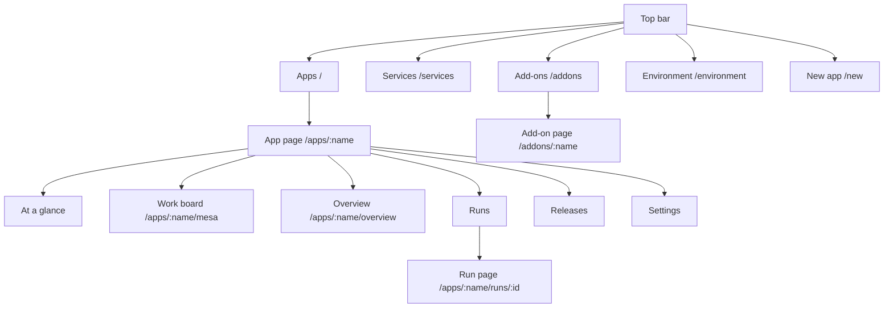

# A tour of the UI

The dashboard is at **https://rendimiento.example.com**. You sign in with GitHub; only [members](../guide/members.md) get in, each with a role. The top bar has five places: **Apps**, **Services**, **Add-ons**, **Environment**, and the **New app** button.

## Apps

The home page lists every app with its phase (*Healthy*, *Progressing*, *Degraded*, *Waiting for first build*…), its latest run and its public addresses. Phases update live.

## New app

One screen, in three moves:

1. **Repository**: on the left, every repository the GitHub App can see, with a filter. Picking one runs detection on it. With nothing of your own to deploy yet, the page (and the empty Apps page) links to **the example**, [rendimiento-ai/hola](https://github.com/rendimiento-ai/hola): one page served by nginx, which GitHub copies to your account.
2. **Configure**: on the right, the app's name and one row per detected service: public URL (subdomain plus zone), size, instances and **Needs** (PostgreSQL, Redis). **More options** unfolds the full form of each service: port, health check, storage, secrets, tests, environment variables and needs (also another service picked from the catalog; pre-ticked when the code uses a client library for them). If the repository has no Dockerfile, you choose between **building from source** (Railpack, recommended) and **adding a generated Dockerfile**. If something is already running in the target namespace (deployed by ArgoCD or by hand), a migration panel offers to **take it over** in place.
3. **Deploy**: for a new repository, rendimiento opens a pull request adding `rendimiento.yaml` (and a Dockerfile if you chose one); the PR is built and checked, and **merging it deploys**. For a repository that already has `rendimiento.yaml`, the first build starts immediately.

## The app page

**At a glance**
:   What most people need, opened first: a cempasúchil that is open and breathing while the app runs, draws its petals in when it is slow or fails now and then, and withers when it does not answer (a green bud before its first release). A hummingbird flies by while an agent works on the app. Beside it, a sentence from [the day's summary](../guide/ai.md#the-days-summary), the share of the week the app was in line (a ring), one dot per day of the week (green, amber when it was slow, red when it did not answer for a while), its visits of the last seven days as bars and against the week before, how fast it answers and how many changes the week had. **For you** shows only when something needs a person: a publication that failed, work of agents waiting for review. **See the details** goes to the work board; **Show me the technical side first** makes the work board open first on this device. With movement off, the flower, the bird and the bars hold still.

**Work board**
:   Everything open in the app, in one list: each line of work is a branch with its pull request, its last run and the encargos about it (or an encargo with no branch), with what it needs and one link to do it. **Your turn**: a branch that passed and can be merged (or that GitHub will not merge without a review), one that conflicts with the main branch, one that failed with nobody on it, an open pull request never tested here, and work an agent delivered for your review. **Working**: a run going on, or an agent that has the encargo. **Spare: can be closed**: an open pull request with the same commit as another (the older one, or the merged one, is the original), and a branch that failed more than a week ago with no pull request. **Merged today**: what went in during the last day. A spare line has **Close** (its pull request is closed without merging, and its branch deleted) or **Delete the branch**; it asks first, and rendimiento never does it by itself. The home page says how many things wait for you in each app, with a link to its board. Agents read the same board with `mesa_leer` before opening a branch.

**Overview**
:   One card per service: ready replicas, public URL, DNS and certificate status, the running image. **Provided for this app** shows the database and cache from `needs:`, which services use them and how to connect from your machine. **Dependency updates** is the per-app Renovate switch. **Resources** is a live tree of the Kubernetes objects (Deployments, pods, Services, Ingresses) with their health.

**Runs**
:   Every CI run: commit, branch, status, duration. **Run** starts a build of the default branch by hand. Above the list, filters by [kind of branch](../guide/builds.md#kinds-of-branch): the main branch, with a pull request, fixes, features, releases, dependencies, other branches.

**Run page**
:   The run's steps as a list, each with a bar for when it ran (bars that overlap ran «a la par», side by side: tests before builds, services in parallel), with its live log, its duration and, for builds, the image digest and the BuildKit daemon that built it. Reused steps show which release they came from.

**Releases**
:   Every release with its commit and images; **Roll back** to any of them.

**Settings**
:   Set the values of the secrets the app declares (they never go to git), and the **Danger zone**: *Disconnect* (stop managing, leave everything running) or *Delete* (after showing exactly what would be removed: namespace, volumes, secrets).

## Services

Every Service in the cluster, as a list on the left in three groups:

- **Your apps & add-ons**: what rendimiento deploys;
- **Elsewhere in the cluster**: deployed by ArgoCD, Helm or `kubectl`;
- **Cluster internals**: ingress, certificates, storage, CI.

Within each group, services are sorted by what they do: Databases, Caches & queues, AI, Storage, Monitoring & analytics, Web & APIs, Developer tools, Platform, each with a dot for whether it is ready. The search looks across every group. Choose a service and the right side shows **where it comes from** (app, repository folder, image, ArgoCD app or Helm release), **what it exposes** (ports, public URLs, LAN address, health check, endpoints), **how to connect** (addresses and a `rendimiento.yaml` snippet to copy) and **who uses it** (found from other workloads' environment variables).

## Add-ons

A list on the left, with a search box across all of it, and the add-on chosen on the right.

- **Needs attention** and **Installed**: each installed add-on with its phase (*In sync*, *Changes waiting*, *Review needed*, *Error*, *Suspended*) and source (those in *Error*, *Review needed* or *Changes waiting* come first, under *Needs attention*). Choosing one shows what a sync would change, object by object with diffs; its Helm hooks and their recent runs; and buttons to **Sync**, **Suspend**, **Edit definition**, **Stop managing** or **Uninstall**.
- **Add from the catalog**: Longhorn, Hajimari, Uptime Kuma, CloudNativePG, *any Helm chart* or *manifests from a git folder*; choosing one opens its short form, with a YAML box to override any chart value. Installing commits a file to the gitops repository.
- **Built in**: Renovate, with its schedule, repositories, configuration and run history.

## Environment

Everything rendimiento depends on, checked live, drawn as a town of Cotija:

- **The bando**: the version of rendimiento that runs and, when a newer one is ready, the **Update** stamp.
- **The street**: each node is a house (the control plane is the parroquia, with its two towers). Lit windows are how busy its processor is, the red skirting rises with its memory, and a note on the door says something is wrong. Tap a house for its CPU, memory, conditions and roles.
- **The signs**: the providers (cluster, DNS, source, registry) and a few requirements (email, storage, the database) hang over the square. A sign opens its *ventanilla*: the provider in use and the ones coming, and for DNS the public IP, when it last changed and an **Update now** button; for email, **Send test email**; and the details and **fix** when something is wrong.
- **Notices in the square**: a cork board with every requirement that needs attention and every failing pod or certificate.
- **What the town needs**: the grouped checks (cluster, networking, TLS, build, integrations), each OK, *Attention*, *Missing* or *Error* with details and a **fix** when something is wrong. For example: the ingress controller, cert-manager and its issuer, storage classes, the BuildKit pool (how many daemons are ready), the registry, the build namespace's isolation, the GitHub App.

## Setup

The very first visit, before a GitHub App exists, shows the one-click setup: rendimiento sends GitHub an App *manifest*, GitHub creates the App and redirects back with its credentials, which are stored in a Kubernetes secret. See [How the platform is deployed](../environment/deploy.md#the-github-app).
